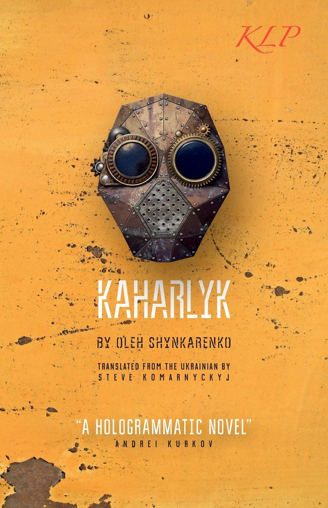

# Kaharlyk (English translation)

**Published:** 2016 · **Translated by:** Stephen Komarnyckyj · **Publisher:** Kalyna Language Press

Translation
Satirical dystopia
Science Fiction

*Kaharlyk* is the English edition of Oleh Shynkarenko's novel *Кагарлик* (2014), translated from Ukrainian by the poet and PEN award-winning translator Stephen Komarnyckyj and published in the UK in September 2016.

[Buy on Amazon UK](https://www.amazon.co.uk/Kaharlyk-Oleh-Shynkarenko/dp/0993197256){ .md-button .md-button--primary }
[About the original novel](kaharlyk.md){ .md-button }

---

## About the book

Ukraine, a hundred years after a war with Russia. The narrator wakes in a hospital-like building with no memory: the occupying army has copied his mind to run its military satellites. He sets out to recover his past and his lost love, and his road leads to Kaharlyk, a small town where time stopped after an experimental weapon was tested.

The novel began on Facebook in December 2012 as daily posts from a "parallel reality of the future" and is written entirely in numbered blocks of exactly 100 words. The English edition keeps that numbering and adds a glossary for readers unfamiliar with the Ukrainian Revolution of 2013–2014. Andrey Kurkov, author of *Death and the Penguin*, called it a "hologrammatic" novel.

For a full discussion of the plot and themes, see the page on the [original Ukrainian novel](kaharlyk.md).

## Edition details

| | |
|---|---|
| **Title** | *Kaharlyk* |
| **Author** | Oleh Shynkarenko |
| **Translator** | Stephen Komarnyckyj |
| **Original** | *Кагарлик* — Serhii Pantiuk Publishing House, 2014; 2nd edition Liuta Sprava, 2015 |
| **Publisher** | Kalyna Language Press Ltd (UK) |
| **Published** | 30 September 2016 |
| **Format** | Paperback, 182 pages, 12.9 × 19.8 cm |
| **ISBN-13** | 978-0-9931972-5-3 |
| **ISBN-10** | 0-9931972-5-6 |
| **Language** | English |

## The translator

**Stephen (Steve) Komarnyckyj** is a UK-based poet and literary translator from Ukrainian. He runs Kalyna Language Press, a small independent publisher dedicated to Ukrainian literature in English. His translation of Bohdan Ihor Antonych's poetry, *Night Music*, received an English PEN award, and his own poetry is collected in *The August Rain*. His translations have appeared in *Index on Censorship*, *The Guardian* and *Modern Poetry in Translation*. He also writes for [Euromaidan Press](https://euromaidanpress.com/author/steve/).

## What readers say

On [Amazon](https://www.amazon.co.uk/Kaharlyk-Oleh-Shynkarenko/dp/0993197256#customerReviews) the English edition has an average of **4.6 out of 5** from 9 ratings (83% five-star, 17% three-star; November 2026). Selected reviews, summarised:

- **Oksana Wenger** (★★★★★, UK, March 2018) compares reading the book to drifting through snatches of overlapping conversations in a crowded, noisy bar. She first resisted its spiral, non-linear structure, then found it by turns sad and funny, and calls it a weird and wonderful journey unlike anything else.
- **Natalia Pavliuk** (★★★★★, UK, November 2017) read the novel three times, twice in Ukrainian and once in English, and says the translation keeps the atmosphere, the author's style and even the jokes. She recommends it to "intellectuals with good sense of humour".
- **Sean O** (★★★★★, Germany, November 2017, verified purchase) calls it experimental literature of rare originality. He notes its satire of both Ukrainian local politics and Russian interference, and praises the translator's glossary.
- **Bugaboo** (★★★★★, USA, April 2018, verified purchase): a fantastic book that may need several readings.

On [Goodreads](https://www.goodreads.com/book/show/32511290) the book has further ratings and reader reviews.

## Press and reviews

- **The Guardian**, 27 June 2016 — news report on the English translation of a dystopian novel written on Facebook during the Maidan protests. [Reprinted by Kyiv Post](https://archive.kyivpost.com/article/content/lifestyle/guardian-dystopian-ukraine-novel-written-on-facebook-during-protests-gets-english-translation-417254.html)
- **Electric Literature**, Nicholas Politan, 27 June 2016 — [A Dystopian Ukrainian Facebook Novel Is Being Published in English](https://electricliterature.com/a-dystopian-ukrainian-facebook-novel-is-being-published-in-english/)
- **Index on Censorship** 45 (2), 2016 — an extract with an essay by the author and translator, "Posting into the Future: How Facebook Updates during the Maidan Protests Were Turned into a Futuristic Novel". [doi:10.1177/0306422016657038](https://doi.org/10.1177/0306422016657038)
- **Sampsonia Way** (City of Asylum, Pittsburgh), August 2016 — an interview, ["A Very Funny Nightmare": A Q&A with Oleh Shynkarenko](https://archive.sampsoniaway.org/interviews/2016/08/10/a-very-funny-nightmare-a-qa-with-oleh-shynkarenko/); [an excerpt from the novel](https://archive.sampsoniaway.org/literary-voices/2016/08/16/an-excerpt-from-kaharlyk-by-oleh-shynkarenko/); and [Kaharlyk and the Ukrainian Revolution: a timeline](https://archive.sampsoniaway.org/blog/2016/08/11/kaharlyk-and-the-ukrainian-revolution-a-timeline/)
- **The Modern Novel** — [review](https://www.themodernnovel.org/?p=39145): very original and complicated, if somewhat disjointed, and in hindsight prescient about the 2022 invasion.
- **Chapter Ukraine** — [catalogue entry](https://chapterukraine.com/kaharlyk/) in its guide to Ukrainian books in English.
- **KUAF, Ozarks at Large**, Kyle Kellams, 19 April 2022 — [radio segment](https://www.kuaf.com/show/ozarks-at-large/2022-04-19/kaharlyk-a-novel-about-ukraine) on the novel after the full-scale invasion.
- **Wikipedia** — [Kaharlyk (novel)](https://en.wikipedia.org/wiki/Kaharlyk_(novel))
