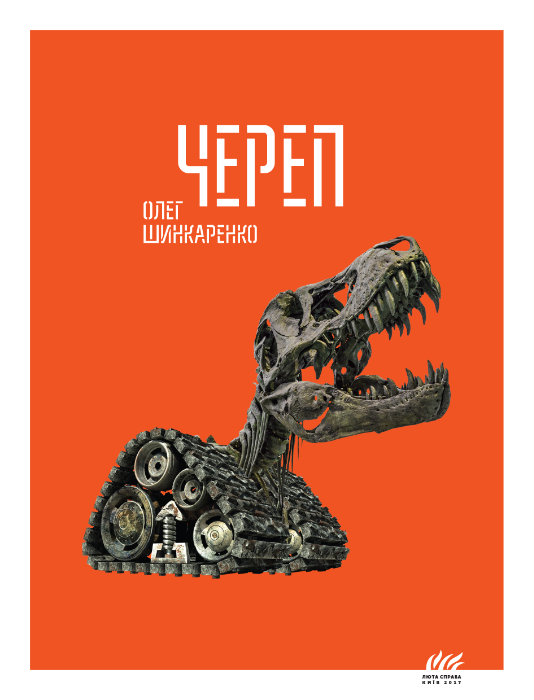

# Череп

**Опубліковано:** 2017 · **Жанр:** Роман · **Оригінал:** *Череп*

Політична проза
Гротеск
Сатира
Українська література

> Війна починається не зі зброї, а з мови, яка не терпить неоднозначності.

---

«Череп» Олега Шинкаренка — не звичайний воєнний роман, і назвати його просто сатирою означало б применшити його задум. Це радше гротескна галюцинація, складена з пропагандистських кліше, імперських міфів і колективної образи. Роман не лише критикує російський імперіалізм — він розбирає механізм мислення, який робить його можливим.

В основі — абсурдна, але промовиста ситуація. Троє героїв, викривлене, майже фольклорне тріо «богатирів», вирушають із найвіддаленіших куточків Росії в Україну на розмальованому, мов сувенір, танку Т-34, щоб воювати з міфічними «бандерівцями», вигаданими кремлівськими пропагандистами. Те, що починається як пародія, швидко темніє: це мандрівка не так географією, як шарами ідеологічного марення.

Світ, крізь який вони їдуть, не має сталої логіки. Реальність перетворюється на казковий простір, що не підкоряється ні фізиці, ні розуму, ні здоровому глузду. Ця хиткість — не стилістична примха: вона показує, як пропаганда руйнує саму здатність пізнавати світ. У «Черепі» ненадійним стає навіть довкілля, бо сприйняття героїв колонізоване.

Оповідь рухає не дія, а віра — точніше, віра нав'язана. Герої не зовсім самостійні: вони носії гасел, історичних симулякрів і чужих наративів. В одному місці пропаганду прямо названо необхідним інструментом: завдяки повторенню ворогів завжди сприймають як «фашистів», і насильство стає не лише прийнятним, а й неминучим. Роман вловлює головне: війна починається не зі зброї, а з мови, яка не терпить неоднозначності.

Що далі триває подорож, то більше герої втрачають рештки людяності. Лишається одна здатність — коритися гіпнотичній логіці пропаганди, яка вигодовує «монстра образи». Це, мабуть, найтривожніший висновок книжки: імперське насильство тут не стратегічне й не раціональне, а емоційне, вкорінене в образі, приниженні й міфологізованій історії.

Шинкаренко загострює цю критику невпинною сатирою. Медійні наративи розсипаються в абсурд: сфабриковані репортажі, суперечливі «факти» й зрежисована реальність показують, як виробляють правду. Показовий епізод: журналісти гарячково вигадують, як пояснити очевидно брехливе воєнне повідомлення, — не щоб докопатися до правди, а щоб брехня звучала переконливо. Тут сатира переходить у діагноз: пропаганда не спотворює реальність, а підміняє її.

Стилістично «Череп» тяжіє до надмірності. Мова роману коливається між грубою розмовною лексикою, ідеологічним жаргоном, містичною маячнею й псевдофілософськими роздумами. Ця какофонія навмисна: вона відтворює шум перенасиченого медіа середовища, де сенси постійно виникають і розчиняються. Це дезорієнтує, часом утомлює, але б'є точно в ціль.

Важливо, що роман не пропонує моральної противаги чи твердої точки опори. Немає погляду «ззовні», який відновив би порядок: читач замкнений у тій самій спотвореній реальності, що й герої. Саме це робить «Череп» більшим, ніж сатира: це модель імперської свідомості, яку читач бачить зсередини.

Зрештою «Череп» — про фатальне злиття міфу й медіа. Імперська амбіція тримається не на цілісній ідеології, а на мінливому мареві, яке підживлюють повторення, страх і бажання. Війна, що народжується з цієї системи, здається водночас неминучою й нереальною — наче кошмар, якого ніхто до кінця не розуміє, але в якому беруть участь усі.

Якщо «Перші українські роботи» показували, як людина розчиняється в технологічній системі, то «Череп» — про інший розпад: про зникнення реальності під тиском наративу. Це жорсткіша, хаотичніша, агресивніша книжка, зате й прямолінійніша у своїй політичній позиції.

Шинкаренко не дає читачеві сміятися спокійно. Як ідеться в передмові, сміятися замало — треба жахнутися.
