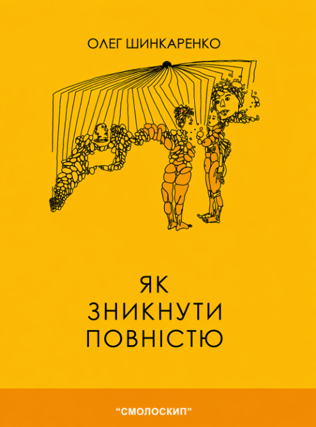
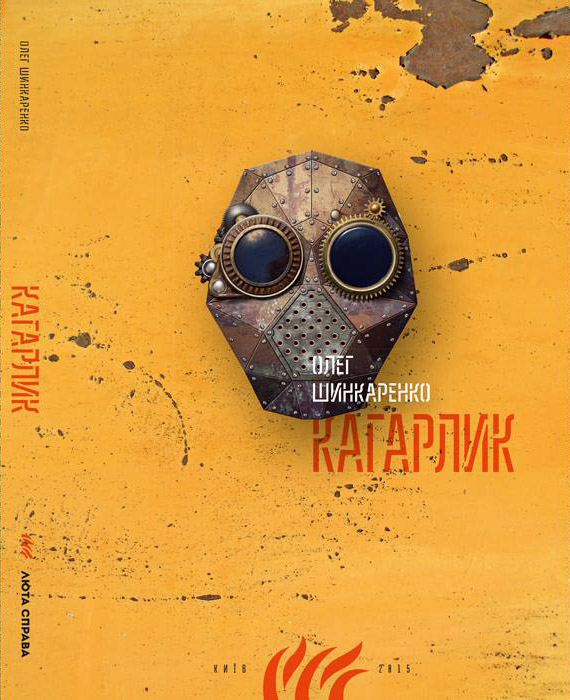
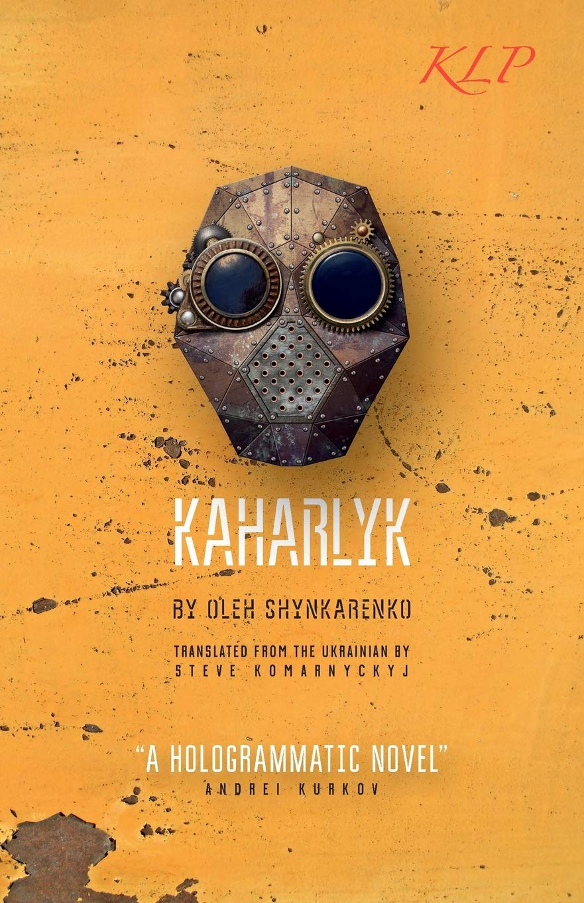
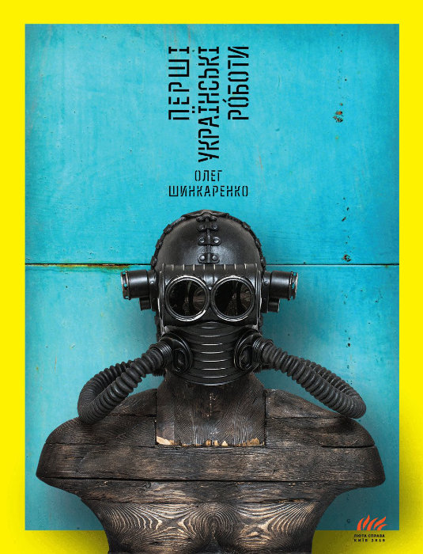
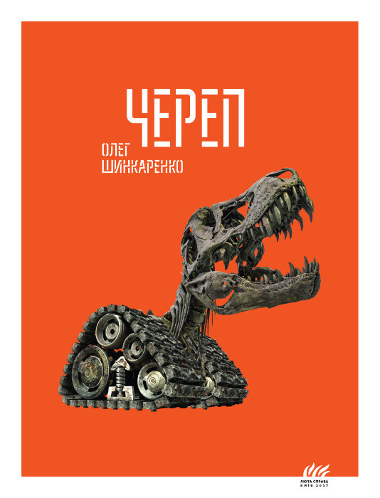
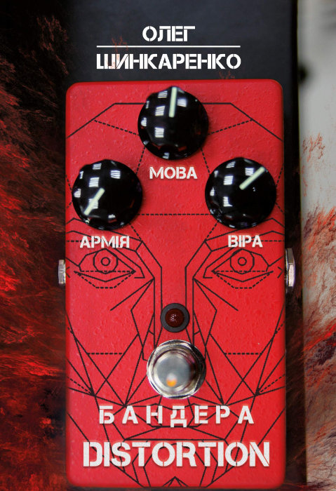

# Мої книги

П'ять книжок українською та один англійський переклад — від сюрреалістичних оповідань і постапокаліптичних романів до політично загостреної сатири. Кожна книжка з метамодерної перспективи досліджує ідентичність, мову, пам'ять і український досвід.

---

  
  

    <strong><a href="yak/">Як зникнути повністю</a></strong>
    2006 · Коротка проза
    
Дебютна збірка, що випробовує на міцність мову й читацьку певність; лауреат літературної премії «Смолоскипа».

  

  
  

    <strong><a href="kaharlyk/">Кагарлик</a></strong>
    2014 · Роман
    
Постапокаліптична Україна через сто років після російсько-української війни — де історія розпалася на чутки, а особистість — на копії свідомості, що змагаються між собою.

  

  
  

    <strong><a href="kaharlyk-en/">«Кагарлик» англійською</a></strong>
    2016 · Роман у перекладі
    
Англійське видання «Кагарлика» в перекладі Стівена Комарницького, Kalyna Language Press, Велика Британія.

  

  
  

    <strong><a href="robots/">Перші українські роботи</a></strong>
    2016 · Роман
    
Фантастичний любовний трикутник, який сам підважує власну логіку й питає, чи лишилася ще якась межа між людським і штучним.

  

  
  

    <strong><a href="cherep/">Череп</a></strong>
    2017 · Роман
    
Гротескна мандрівка крізь пропаганду й імперський міф: війна починається не зі зброї, а з мови, яка не терпить неоднозначності.

  

  
  

    <strong><a href="bandera/">Бандера Distortion</a></strong>
    2019 · Роман
    
Роман, що не зводить Бандеру до одного значення, — незручне дослідження того, як суспільство творить, звеличує або демонізує історичних постатей.

  

