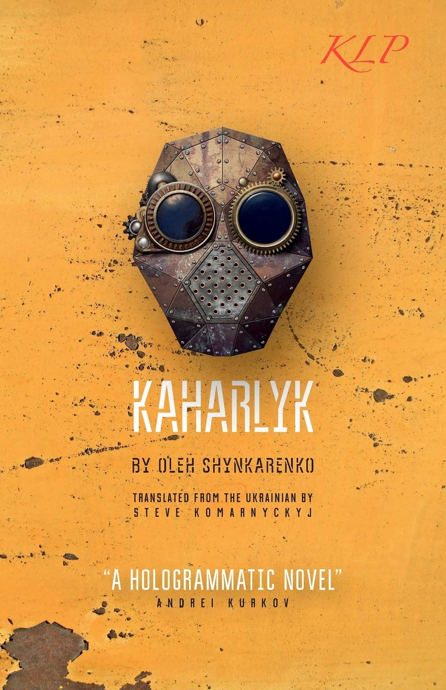

# «Кагарлик» англійською

**Опубліковано:** 2016 · **Переклад:** Стівен Комарницький · **Видавництво:** Kalyna Language Press

Переклад
Сатирична антиутопія
Наукова фантастика

*Kaharlyk* — англійське видання роману Олега Шинкаренка «Кагарлик» (2014). Його переклав поет і лауреат премії English PEN Стівен Комарницький; книжка вийшла у Великій Британії у вересні 2016 року.

[Купити на Amazon UK](https://www.amazon.co.uk/Kaharlyk-Oleh-Shynkarenko/dp/0993197256){ .md-button .md-button--primary }
[Про оригінальний роман](kaharlyk.md){ .md-button }

---

## Про книжку

Україна через сто років після війни з Росією. Оповідач прокидається в схожій на лікарню будівлі без пам'яті: окупаційна армія скопіювала його розум, щоб керувати військовими супутниками. Він вирушає шукати своє минуле й утрачене кохання, і дорога веде його до Кагарлика — містечка, де час зупинився після випробування експериментальної зброї.

Роман почався у Facebook у грудні 2012 року як щоденні дописи з «паралельної реальності майбутнього» і повністю складається з пронумерованих фрагментів рівно по 100 слів. Англійське видання зберігає цю нумерацію й має глосарій для читачів, які не знають подробиць Революції гідності. Андрій Курков назвав «Кагарлик» «голографічним» романом.

Детальніше про сюжет і теми — на сторінці [оригінального роману](kaharlyk.md).

## Про видання

| | |
|---|---|
| **Назва** | *Kaharlyk* |
| **Автор** | Олег Шинкаренко |
| **Перекладач** | Стівен Комарницький |
| **Оригінал** | «Кагарлик» — Видавець Сергій Пантюк, 2014; 2-ге видання «Люта справа», 2015 |
| **Видавництво** | Kalyna Language Press Ltd (Велика Британія) |
| **Дата виходу** | 30 вересня 2016 |
| **Формат** | М'яка обкладинка, 182 с., 12,9 × 19,8 см |
| **ISBN-13** | 978-0-9931972-5-3 |
| **ISBN-10** | 0-9931972-5-6 |
| **Мова** | англійська |

## Перекладач

**Стівен (Стів) Комарницький** — поет із Великої Британії, і літературний перекладач з української. Він керує Kalyna Language Press, незалежним видавництвом, що публікує українську літературу англійською. Його переклад поезії Богдана-Ігоря Антонича «Night Music» відзначено премією English PEN; власна поетична збірка — *The August Rain*. Його переклади друкували *Index on Censorship*, *The Guardian* і *Modern Poetry in Translation*. Також пише для [Euromaidan Press](https://euromaidanpress.com/author/steve/).

## Відгуки читачів

На [Amazon](https://www.amazon.co.uk/Kaharlyk-Oleh-Shynkarenko/dp/0993197256#customerReviews) англійське видання має середню оцінку **4,6 з 5** на основі 9 оцінок (83% — п'ять зірок, 17% — три; листопад 2026). Вибрані відгуки в переказі:

- **Оксана Венгер** (★★★★★, Велика Британія, березень 2018) порівнює читання з блуканням між уривками розмов у переповненому галасливому барі. Спершу нелінійна, спіральна будова її насторожила, але згодом книжка видалася то сумною, то смішною — дивною й чудовою мандрівкою, не схожою ні на що.
- **Наталія Павлюк** (★★★★★, Велика Британія, листопад 2017) прочитала роман тричі — двічі українською й раз англійською — і пише, що переклад зберіг атмосферу, авторський стиль і навіть жарти.
- **Sean O** (★★★★★, Німеччина, листопад 2017, підтверджена покупка) називає роман рідкісно оригінальною експериментальною літературою, відзначає сатиру і на українську місцеву владу, і на російське втручання та хвалить глосарій перекладача.
- **Bugaboo** (★★★★★, США, квітень 2018, підтверджена покупка): чудова книжка, яку, можливо, доведеться перечитати кілька разів.

На [Goodreads](https://www.goodreads.com/book/show/32511290) є інші оцінки й відгуки читачів.

## Преса та рецензії

- **The Guardian**, 27 червня 2016 — новина про англійський переклад антиутопії, написаної у Facebook під час Майдану. [Передрук у Kyiv Post](https://archive.kyivpost.com/article/content/lifestyle/guardian-dystopian-ukraine-novel-written-on-facebook-during-protests-gets-english-translation-417254.html)
- **Electric Literature**, Ніколас Політан, 27 червня 2016 — [A Dystopian Ukrainian Facebook Novel Is Being Published in English](https://electricliterature.com/a-dystopian-ukrainian-facebook-novel-is-being-published-in-english/)
- **Index on Censorship** 45 (2), 2016 — уривок і есей автора та перекладача «Posting into the Future». [doi:10.1177/0306422016657038](https://doi.org/10.1177/0306422016657038)
- **Sampsonia Way** (City of Asylum, Пітсбург), серпень 2016 — [інтерв'ю «A Very Funny Nightmare»](https://archive.sampsoniaway.org/interviews/2016/08/10/a-very-funny-nightmare-a-qa-with-oleh-shynkarenko/), [уривок із роману](https://archive.sampsoniaway.org/literary-voices/2016/08/16/an-excerpt-from-kaharlyk-by-oleh-shynkarenko/) і [хронологія «Кагарлика» та Революції гідності](https://archive.sampsoniaway.org/blog/2016/08/11/kaharlyk-and-the-ukrainian-revolution-a-timeline/)
- **The Modern Novel** — [рецензія](https://www.themodernnovel.org/?p=39145): дуже оригінальний і складний, хоч і дещо фрагментарний роман, який сьогодні виглядає пророчим щодо вторгнення 2022 року.
- **Chapter Ukraine** — [запис у каталозі](https://chapterukraine.com/kaharlyk/) української літератури англійською.
- **KUAF, Ozarks at Large**, Кайл Келламс, 19 квітня 2022 — [радіосюжет](https://www.kuaf.com/show/ozarks-at-large/2022-04-19/kaharlyk-a-novel-about-ukraine) про роман після повномасштабного вторгнення.
- **Вікіпедія** — [Kaharlyk (novel)](https://en.wikipedia.org/wiki/Kaharlyk_(novel))
