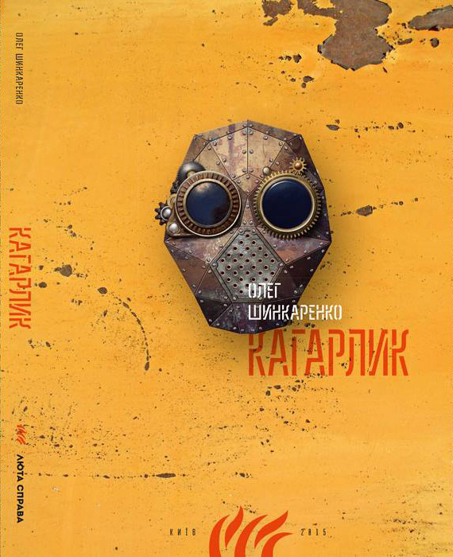

# Кагарлик

**Опубліковано:** 2014 · **Жанр:** Роман · **Оригінал:** *Кагарлик*

Постапокаліпсис
Наукова фантастика
Сатира
Українська література

> Апокаліпсис — не одноразова подія, а стан мислення: світ, де історія стала чутками, а особистість — набором копій свідомості, що змагаються між собою.

---

У романі Олега Шинкаренка «Кагарлик» апокаліпсис — не одноразова подія, а стан мислення. Світ скінчився — у ядерній війні, в окупації, у повільному розпаді мови, — але люди й далі говорять, плутають спогади й вигадують пояснення тому, що лишилося.

Вихідна ситуація сувора. Через сто років після російсько-української війни Україна — спустошена, напівбезлюдна країна: Київ перетворився на небезпечні руїни, пам'ятки культури палять, щоб зігрітися, а історія розпалася на чутки й реліквії. Серед цього попелища постає Кагарлик — місце, про яке говорять не так як про пункт призначення, як про метафізичний стан: місто, де зупинився час, тож гіршого вже не станеться, але й кращого теж.

У центрі — Олександр Сагайдачний, який утратив пам'ять не лише через травму, а й через технологічне втручання: окупанти грубо скопіювали його свідомість. Наслідок — не подвоєння, а розщеплення. Сагайдачний існує водночас як він сам і як дві суперницькі завантажені свідомості: одна вбудована в бунтівний супутник, друга — в лояльну до Кремля систему, і кожна має власну ідеологію та інтонацію. Драма роману — не лінійні пошуки, а низка зіткнень між цими версіями «я», кожна з яких претендує на владу над реальністю.

Шинкаренко складає оповідь з уламків. Книжка виросла зі щоденних фрагментів по 100 слів у Facebook, і це дає їй особливий ритм: епізоди руху змінюються монологами, філософськими відступами й архівними курйозами. Мандрівка до Кагарлика стає блуканням серед різних пояснень світу: священик міркує про час, що тече водночас уперед і назад; учені сперечаються, чи вцілілі тексти — уламки втраченого цілого, чи вже самі по собі ціле; селяни вибудовують цілі вірування довкола штучно виведених підземних істот.

Деталі точні й часто похмуро-смішні. В одному селі чоловіки ховаються від мобілізації до російської армії, розширюючи підвали до велетенських підземних мереж; згодом там постає економіка на трюфелях, а нові породи кротів стають об'єктом поклоніння. У Києві самопроголошені «мери» ведуть справжню війну за порожні титули, хоча саме слово давно втратило будь-який зміст. Деінде вцілілі відтворюють історію за етикетками пляшок і клаптями упаковки, і «Горбачов» із політика перетворюється на міфічний або хибно зрозумілий знак.

Ці епізоди об'єднує не сюжет, а питання пізнання. Роман знову й знову повертається до хиткості ідентичності й сенсу. Голос мертвої жінки, збережений у пристрої — *морфоні*, — стає предметом суперечки: чи вона ще вона сама, якщо від неї лишився тільки голос? Імена, спогади й навіть час виявляються умовними інструментами — зручностями, а не істинами. Мова, як сказано в одному з фрагментів, маскує «дефекти всесвіту», даючи сталі назви принципово нестабільним явищам.

Релігії й ідеології ведеться не краще. В одному з найхолодніших фрагментів безтілесна свідомість називає саму ідею індивідуальності ілюзією, а системи вірувань — передусім виправданням насильства й ієрархії. Віра, як і пам'ять, стає ще одним інструментом — гнучким, маніпулятивним і часто руйнівним.

Сатира Шинкаренка невблаганна, але не безладна. Абсурди накопичуються з внутрішньою логікою: коли інституції руйнуються, люди не перестають вірити — вони вірять ще відчайдушніше, надаючи ваги будь-яким уламкам. Сам Кагарлик, де зупинився час, — не так утопія, як остання лінія оборони від невизначеності, відмова ризикувати будь-якими змінами.

Роман не дає простих висновків. Його будова, безперечно, нерівна — це визнає й сам автор, — але ця нерівність невіддільна від теми. «Кагарлик» не стільки про кінець світу, скільки про кінець цілісності. Він питає, що буває, коли історія, ідентичність і мова розходяться, — і чи можуть люди за таких умов жити, думати й розповідати далі.

Відповідь тривожна: можуть. Але тільки перетворивши саму реальність на щось умовне, складене з уламків, — як роман, який ми читаємо.

---

**Англійською:** *Kaharlyk*, переклад Стівена Комарницького, Kalyna Language Press, 2016 — [про видання, відгуки читачів і преси](kaharlyk-en.md).
