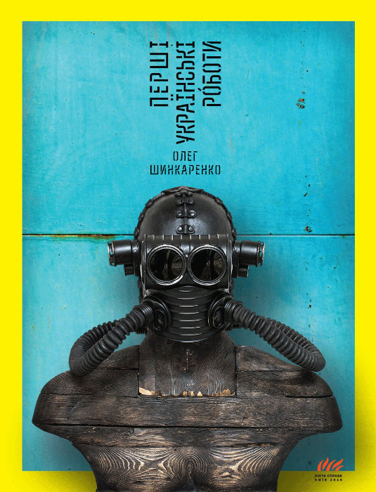

# Перші українські роботи

**Опубліковано:** 2016 · **Жанр:** Роман · **Оригінал:** *Перші українські роботи*

Наукова фантастика
Антиутопія
Сатира
Українська література

> Роман не про машини, а про те, як розмиваються визначення, — і про світ, де бути людиною, можливо, означає вже нічим не відрізнятися від створених нами систем.

---

Спершу «Перші українські роботи» видаються впорядкованішою й доступнішою книжкою: тут є впізнаваний сюжет, персонажі й емоційна напруга. Але ця стабільність оманлива. Під поверхнею текст послідовно руйнує власну логіку й перетворюється на фрагментоване, самоіронічне дослідження ідентичності в технологізованому світі.

У центрі — начебто класичний любовний трикутник. Олена, яка з домогосподарки поступово стає дедалі свідомішою, навіть феміністичною героїнею, опиняється між чоловіком Андрієм, невдахою й невпевненим менеджером, і роботом Петром, чия перевага не лише фізична, а й екзистенційна. Цей трикутник працює на кількох рівнях: як особиста драма і як метафора протистояння людської недосконалості та інженерної ефективності.

Навколо цієї інтимної історії розгортається ширше фантастичне тло. Суспільство виснажене тривалим геополітичним конфліктом і стрімкою технологічною експансією; роботи поступово витісняють людей звідусіль — із праці, управління й навіть особистих стосунків. Це відбувається не раптом і не силою, а майже непомітно, в ім'я оптимізації й зручності, — доки людина не починає почуватися зайвою.

Роман вирізняє те, що він відмовляється бути стабільним. Сюжет, спершу лінійний, дробиться й множиться, пародіюючи і себе, і традицію наукової фантастики, з якою веде діалог, — від Лема до Філіпа К. Діка. Оповідь усвідомлює себе, загортається сама в себе й підриває власну цілісність. Це вже не так історія, як система, що поводиться непередбачувано.

Ця нестабільність форми відповідає головній філософській темі книжки — розмиванню ідентичності. Текст раз у раз питає, чи лишилася ще якась справжня межа між людським і штучним. Особистість постає не чимось вродженим, а набором вбудованих програм — соціальних, ідеологічних, технологічних. У цьому сенсі прихований заклик роману — *«знайди кіборга в собі»* — звучить не як провокація, а як неминучість.

Частиною цієї кризи стає й мова. Роман швидко перемикається між регістрами — інтимним діалогом, мовою медіа, науковими поясненнями, канцеляритом — і творить розірваний простір спілкування. Читати його — наче орієнтуватися серед систем, що вже не стикуються одна з одною. Цей ефект підсилює ідея з передмови: текст діє як когнітивний вірус, що змінює сприйняття читача зсередини.

Водночас роман має потужний сатиричний заряд. Він висміює не лише сліпу віру в технології, а й суспільне та політичне середовище, яке робить такі зміни можливими. Навіть спроби опору, зокрема антитехнологічні рухи, виглядають двозначно — ніби це лише ще один шар тієї самої запрограмованої реальності.

Найбільший виклик книжки — її насиченість. Безперервна самопародія, фрагментарність і щільність ідей можуть дезорієнтувати, часом навіть утомлювати. Але ця складність входить у задум: роман не терпить пасивного читання й вимагає від читача участі, розгубленості й переосмислення.

Зрештою «Перші українські роботи» — не про машини, а про те, як зникають чіткі визначення. Людина тут уже не стала категорія, а плинна конструкція, яку формують код, системи й зовнішні впливи. Шинкаренко не пропонує розв'язки. Він залишає читача там, де сама ідентичність здається умовною, — де бути людиною, можливо, означає нічим не відрізнятися від систем, які ми створюємо.
