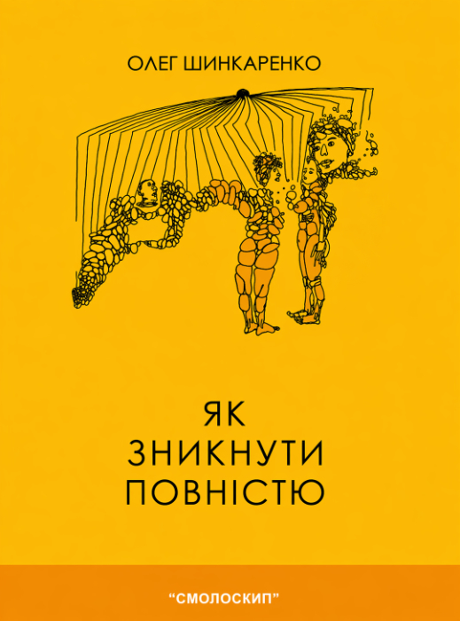

# Як зникнути повністю

**Опубліковано:** 2006 · **Жанр:** Коротка проза · **Оригінал:** *Як зникнути повністю*  
**Нагорода:** Літературна премія «Смолоскип» 2006

Коротка проза
Сюрреалізм
Українська література

> Невеликі розриви у звичному світі — дебют, який перевіряє, наскільки можна вигнути мову, форму й читацьке відчуття опори.

---

Бувають дебюти, що не так представляють новий голос, як тихо провокують: їм цікавіше з'ясувати, наскільки цей голос здатен розтягнути мову, форму й читацьку певність. «Як зникнути повністю» Олега Шинкаренка, лауреат премії «Смолоскипа» 2006 року, саме з таких. Це збірка короткої прози, водночас близької й відчуженої, грайливої й ледь загрозливої.

Шинкаренко пише так, ніби реальність — тонка плівка, що от-от прорветься. Його оповідання рідко починаються з чогось видовищного. Вони заходять через знайоме — розмову, стосунки, спогад — і лише згодом, спершу непомітно, хиляться до тривожного. В одному з найсильніших текстів чоловік захоплюється думкою поступово стерти себе зі світу: відмовляється від звичок, стосунків і навіть мови. Те, що починалося як філософська вправа, обертається моторошним експериментом із самознищення, і стриманість оповіді робить фінал іще гнітючішим.

Деінде автор показує гострий, майже сатиричний погляд. Історія начебто звичайної пари перетворюється на сюрреалістичну анатомію залежності, де близькість стає буквальним сплетенням тіл, ідентичностей і бажань. Виходить гротескно й ніжно водночас — на тій незручній межі, де кохання переходить у розчинення.

Кілька оповідань балансують на межі абсурду, але ніколи не безцільно. В одному з них персонаж блукає бюрократичною системою, яка, здається, керує не документами, а самим існуванням, видаючи дозволи на пам'ять, ідентичність і навіть на присутність. Гумор тут сухий, ніби мимохідний, але в ньому чути пострадянські тривоги: системи, що живуть усупереч логіці й непомітно визначають людські життя.

Книжку вирізняє не лише сміливість задуму, а й дисципліна інтонації. Шинкаренко не піддається спокусі все пояснити. Його проза — скупа, стримана, подекуди лірична — лишає місце для неоднозначності й довіряє читачеві побути з дискомфортом, замість його розвіяти. Якщо в збірці є наскрізна тема, то це крихкість власного «я»: як легко його змінити, стерти чи поглинути.

Як на дебют, збірка напрочуд упевнена. Вона пропонує не цілісний світогляд, а низку ретельно вибудуваних збурень: кожне оповідання — маленький розрив у тканині звичного. Із сьогоднішньої відстані премія «Смолоскипа» виглядає не авансом, а визнанням того, що новий автор уже відбувся.

Персонажі Шинкаренка часто шукають утечі — від стосунків, від систем, від себе. Але книжка підказує тривожніше: зникнути повністю неможливо. Завжди щось лишається — спогад, слід чи ледь відчутний неспокій, який не відпускає читача й після останньої сторінки.
