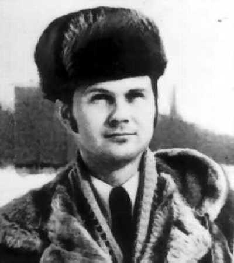

# Volodymyr Zayets: A Ukrainian Postmodern behind the Iron Curtain

**Oleh Shynkarenko (Pécs)**  
*Journal of Science Fiction and Philosophy* 9 (2026): 1–26 · ISSN 2573-881X · open access  
Original publication: [jsfphil.org/volume-9-2026/zayets-ukrainian-postmodern](https://jsfphil.org/volume-9-2026/zayets-ukrainian-postmodern/) · [PDF](https://jsfphil.org/wp-content/uploads/2026/10/167-shynkarenko-zayets-ukrainian-postmodern.pdf)  
DOI: [10.5281/zenodo.23423460](https://doi.org/10.5281/zenodo.23423460)

This article argues that the Ukrainian science fiction writer Volodymyr Zayets (1949–2003) was an unwitting postmodern writer, one who registered the collapse of modern hierarchical order without access to the theoretical vocabulary that named it. Similarly, this author's work was never considered postmodern in Ukrainian literary studies: he was considered a science fiction writer whose works were published mainly in children's literature publishing houses. However, Zayets diagnosed the Soviet hierarchy and its institutions as decorative survivals that continued to function ritually after their legitimating core had died. Reading his major novellas, *Plaster Cramp* (1990) and *Heavy Shadows* (1991), alongside the collection *The Temponauts* (1986), my article traces several features that Zayets shared with Western postmodern theory. It argues that Zayets reached these positions independently, through lived experience of late socialism rather than through Lyotard, Derrida, or Baudrillard, making him a rare case of postmodernism arrived at symptomatically.

**Keywords:** Volodymyr Zayets, Ukrainian science fiction, postmodernism, late socialism, Soviet literature, hierarchy, simulacrum, Baudrillard, Lyotard, Foucault

!!! note "Copyright and licence"
    © 2026 Oleh Shynkarenko. First published in the *Journal of Science Fiction and Philosophy* under a Creative Commons Attribution–NonCommercial (CC BY-NC 4.0) licence. Please cite the original publication.

---

## 1. Introduction

Among the Ukrainian science fiction writers of the late Soviet period, Volodymyr Zayets (1949–2003) occupies a place that literary history has not yet adequately mapped. A pediatrician by training and a sci-fi writer by vocation, Zayets produced, in the final decades of the Soviet Union's existence, a body of work that registers the silent disintegration of the hierarchical order on which both the Soviet state and the broader project of modernity rested.

Zayets was one of the first Ukrainian authors to *feel* the collapse of Soviet modernist archaic hierarchies, and that made him, largely without theoretical self-awareness, a postmodern writer. To the best of my knowledge, this idea has not yet been addressed in the existing scholarship, and the postmodern side of Zayets’s creative personality has so far received little if any sustained critical attention. For example, the author of the monograph “Ukrainian Science Fiction: A Historical and Thematic Survey,” Volodymyr Smyrniv, in all 472 pages of his study, apart from purely summarizing the plots of Zayets’s works, devoted to their analysis only one sentence: “his humorous science‑fiction short stories are quite engaging and testify to the writer’s rich imagination” (Smyrniv 2019, 365). In fact, the polemic with Smyrniv’s work was one of the reasons for writing this dissertation. In my view, the rich textual material at the scholar's disposal offered more than his reading ultimately draws from it.

The term “feel” is essential for my view. Zayets did not read Derrida or Lyotard; in the 1970s and 1980s the canonical texts of poststructuralism were untranslated, and inaccessible to a Soviet provincial physician writing humoresques for the satirical journal *Perets*. What Zayets possessed instead was what we could call a physician's diagnostic eye. He saw the problems of the society in which he lived at once from the perspective of a professional physician and from that of a philosopher. His two major late novellas, *Гіпсова судома* (*Plaster Cramp*, 1990) and *Важкі тіні* (*Heavy Shadows*, 1991), examine two societies — one a phantasmagoric replica of stagnation-era Ukraine, the other a totalitarian theocracy on the distant planet Firbolgia — and arrive in both cases at the same finding: the vertical structures (so typical for modernism!) of authority that organize these worlds are dead tissue. They continue to stand, to demand obedience, to distribute punishment and reward, but they no longer organize meaning. They have become, in the strict sense, *decorative hierarchies*: ornamental survivals of a vertical order whose legitimating core has quietly liquefied, because “the grand narrative has lost its credibility” (Lyotard 1984, 37).

Medicine trains its practitioners to distinguish between a living organ and a necrotic one that retains its outward shape, and Zayets imported this clinical habit directly into his poetics. His fictional toponyms and anthroponyms are built from medical terminology; his protagonists are physicians or are subjected to quasi-medical procedures; his societies are presented as patients whose diagnosis the reader is invited to establish. The wind-up keys protruding from the backs of the citizens of Kifozovo in *Plaster Cramp* — a town whose name derives from *kyphosis*, the pathological curvature of the spine — are simultaneously a satirical image of Soviet automatism and a clinical symptom: the deformation of a social body that has been bent into an unnatural posture for too long.

This article will proceed in five steps: Section 2 reconstructs the history of hierarchy as a legitimating structure of the premodern and modern worlds and explains why, in the postmodern epoch, hierarchies persist only as decoration. Section 3 addresses a problem specific to the Soviet context: how postmodern sensibility could penetrate the Iron Curtain and reach Ukrainian science fiction writers who had no access to postmodern theory. Section 4 presents Zayets's biography, with particular attention to the medical profession that shaped his language and his fate. Sections 5 and 6 offer readings of *Plaster Cramp* and *Heavy Shadows* respectively, arguing that the two novellas form a diptych: the first deconstructs the decorative hierarchy of late Soviet “developed socialism” from within, while the second projects the same anatomy of power onto an extraterrestrial screen where its mechanisms can be displayed with a candor that even glasnost-era censorship would not have permitted in a terrestrial setting. Section 7 showcases Zayets’s postmodern humor in the “Temponauts” short story collection.

## 2. The History of Hierarchies and Their Decorative Turn

The word “hierarchy” — *hierarchia*, sacred rule — enters European thought through Pseudo-Dionysius the Areopagite, for whom the orders of angels and the orders of the Church mirrored one another in a single continuous ladder ascending toward God. The medieval *scala naturae*, the great chain of being, generalized this ladder into an ontology: every entity, from stone to seraph, occupied a rung whose position was fixed by divine intention, and social subordination was therefore not a political arrangement but a cosmological fact: the conception of “the universe as a 'Great Chain of Being,' composed of an immense, or … infinite, number of links ranging in hierarchical order from the meagerest kind of existents … through 'every possible' grade up to the *ens perfectissimum*” (Lovejoy 1936, 59). To rebel against one's place was to rebel against the structure of reality itself.

Modernity did not reject this vertical imagination; it secularized and re-founded it. The Enlightenment replaced the *ens perfectissimum* with *Reason*, the Hegelian system replaced it with *Spirit* unfolding through history toward absolute knowledge, and the Marxist inversion of Hegel replaced it with the laws of historical materialism, at whose summit stood the working class designated as the engine of the class struggle. It is here that the genealogy of the Soviet hierarchy and, as I call it, “techno-communism”, properly begins. By “techno-communism” I mean the early-Soviet conviction — rooted in Marxist materialism and positivist faith in science — that technological progress would by itself deliver social liberation and a classless utopia, with the machine cast as the proletariat's partner in building it (Shynkarenko 2025, 431).

The very term “hegemon,” which Soviet schoolchildren learned as a synonym for the proletariat, descends from the Greek *hēgemōn* — leader, guide, military commander. Lenin, in the period between 1905 and 1917, fixed the term in the revolutionary lexicon: the proletariat was to be the hegemon of the communist revolution: “The proletariat must carry to completion the democratic revolution, by allying to itself the mass of the peasantry in order to crush by force the resistance of the autocracy and to paralyse the instability of the bourgeoisie” (Lenin 1962, 100). Antonio Gramsci later transformed “hegemony” into a subtler instrument, an analysis of how a ruling group secures consent rather than mere submission — “the 'spontaneous' consent given by the great masses of the population to the general direction imposed on social life by the dominant fundamental group; this consent is 'historically' caused by the prestige (and consequent confidence) which the dominant group enjoys because of its position and function in the world of production” (Gramsci 1971, 12) — but in the codified ideology of the USSR the older, simpler usage prevailed. The proletariat-hegemon stood at the apex of a new chain of being, with the Party as its consciousness and the General Secretary as the personification of that consciousness. Ironically, this arrangement reproduced closely a theological scheme again: the proletariat as God the Father, the Party as the Holy Spirit, and the General Secretary as the Son. The Soviet state was thus not an anti-hierarchical project that degenerated into hierarchy; it was, from the beginning, a modern restoration of the sacred ladder, with history substituting for God.

The postmodern moment can be defined as the historical point at which such ladders ceased to be believed while continuing to be built. No single philosopher pronounced the formula “all hierarchies are decorative” — the phrase is a popularizing condensation rather than a quotation — but the converging work of the French poststructuralists provided its theoretical justification. Jean-François Lyotard claimed that the great legitimating stories of emancipation and speculative knowledge, which had underwritten every modern hierarchy of value, lost their credibility, leaving institutions to operate on performativity alone: “Simplifying to the extreme, I define postmodern as incredulity toward metanarratives” (Lyotard 1984, xxiv).

Jacques Derrida demonstrated that the only center of any hierarchy is absent, and that every structure therefore rests on a vacancy it must conceal: “The center is at the center of the totality, and yet, since the center does not belong to the totality (is not part of the totality), the totality has its center elsewhere. The center is not the center” (Derrida 1978, 279).

Michel Foucault historicized the vertical institutions of modernity — the asylum, the clinic, the prison — showing them to be contingent configurations of power and knowledge rather than expressions of any natural or rational order; the hierarchy does not descend from truth, it *produces* the truths it needs: “power produces; it produces reality; it produces domains of objects and rituals of truth” (Foucault 1977, 194); “Truth is a thing of this world: it is produced only by virtue of multiple forms of constraint. And it induces regular effects of power” (Foucault 1980, 131).

Gilles Deleuze and Pierre-Félix Guattari opposed to the arborescent model of knowledge and society — the root-tree with its trunk, branches, and subordinate twigs — the figure of the rhizome, a decentered network in which “any point of a rhizome can be connected to anything other, and must be. This is very different from the tree or root, which plots a point, fixes an order” (Deleuze and Guattari 1987, 7).

To these four operations Jean Baudrillard added a fifth that is particularly relevant to the Soviet case, where the techno-communism ideas were not already relevant, but still actively used officially: the theory of simulation. In this theory signs no longer refer to any reality but circulate as copies without originals, “hyperreality” masking the absence of the real: simulation “is the generation by models of a real without origin or reality: a hyperreal” (Baudrillard 1994, 1).

All five accounts share the same idea that hierarchies have been *unmasked as constructions* — historically variable, textually generated, performatively maintained. A hierarchy becomes a façade, a ritual, a decoration. Alexei Yurchak's study of the last Soviet generation describes precisely this condition under the name of “hypernormalization”: authoritative discourse in the late USSR became a fixed, endlessly reproduced form whose constative meaning no one any longer engaged; what mattered was the performance of the ritual, not belief in its content: “The language had become what I term hypernormalized — that is, the process of its normalization did not simply affect all levels of linguistic, textual, and narrative structure but also became an end in itself, resulting in fixed and cumbersome forms of language that were often neither interpreted nor easily interpretable at the level of constative meaning” (Yurchak 2006, 50). The May Day slogan, the unanimous vote, the report on overfulfilled plans — these were the wind-up keys of a society that still went through the motions of the sacred ladder while everyone privately knew the ladder led nowhere. The Soviet Union of the stagnation era was thus, without knowing the word, one of the most postmodern societies in Europe: a civilization-scale demonstration that a hierarchy can survive the death of its own legitimation, persisting as pure ornament — until the moment, swift and almost bloodless, when the ornament is simply taken down.

It is this condition — hierarchy as necrotic tissue, as decoration awaiting demolition — that Zayets's late fiction diagnoses. Before turning to the texts, however, we must ask how such a diagnosis became *thinkable* for a Soviet Ukrainian science fiction writer at all.

## 3. Postmodernism through the Iron Curtain

So, how did postmodern ideas reach Ukrainian science fiction writers of the 1970s and 1980s, given that these writers could not read postmodern authors — who were untranslated or unavailable[^1] — and for the most part did not command the languages in which postmodernism was being written? In the strict sense, the ideas did not reach them at all. What reached them was the *condition* that those ideas described. Postmodernism arrived in Soviet Ukraine not as a theory but as an experience — the experience of living inside a grand narrative that had visibly died while remaining compulsory — and the writers who registered this experience reinvented postmodern devices independently, as a diagnostic necessity rather than a borrowed fashion.

Several channels and pressures combined to produce this effect. The first was the internal decomposition of socialist realism itself. By the late 1970s the gap between the official discourse of triumphant progress and the lived reality of queues, cynicism, Afghanistan, and finally Chornobyl had widened into what Soviet critics of the *perestroika* period (1985-1991) themselves called a crisis of social consciousness. A literature whose mandatory master plot was the movement of society toward a radiant future could not survive the universal private knowledge that society was moving nowhere. The result, observable across late Soviet literature, was an involuntary turn toward irony, fragmentation, and the play of incompatible discourses — the formal repertoire that Western criticism labels postmodern, generated here not by aesthetic choice but by the collapse of the only sanctioned metanarrative: “Historical perspective collapsed, and we felt ourselves carried off into some kind of Beyond.” (Epstein 1995, 71). Mikhail Epstein's argument that Soviet ideology, as a system of signs that had long since detached itself from referents, was itself a vast simulacrum — so that Russian and Soviet culture entered the postmodern condition independently of the West — applies with equal force to Soviet Ukraine; Epstein defines this postmodernism *avant la lettre* as simulation, “the production of reality as a series of plausible copies” (189).

Another channel was indigenous. Ukrainian literature possessed its own pre-adaptations to the postmodern: the Ukrainian experimental modernism of the 1920s that had been executed,[^2] “a national cultural flowering brutally crushed by the Stalinist repressions of the 1930s” (Hryn 2004–2005, 67), and the so-called *khymerna proza* — the “chimeric prose” of Oleksandr Ilchenko and Valerii Shevchuk, with its myth-making, intertextuality, grotesque, and unstable narrators. Tamara Hundorova has shown that Ukrainian postmodernism of the 1980s and 1990s grew as much from these domestic roots as from any Western import, constituting a “post-Chornobyl library” in which the Chornobyl nuclear station catastrophe of 1986 functioned as the symbolic end of the Soviet world-text: “the emergence of postmodernism in Ukraine… has its unique points. Aesthetic devices that can be related to the forms of early postmodernism, such as irony, quotation, the creation of alternative worlds, and so forth, were already in use within the system of socialist realism” (Hundorova 2019, 64).

Marko Pavlyshyn, analyzing the same period, clearly showed that postmodernism in Ukraine was a reaction to the modernist ambitions of the USSR as a communist empire: “Postmodernism … is, above all, the conviction regarding the failure of the project of modernity, with its rationalist self-confidence, its ambition to be the savior of humankind, and its claim to universality, which supposedly justified its aggressive authority” (Pavlyshyn 1997, 23).

The peculiar institutional position of science fiction was very important too. As a genre officially classified as juvenile and popular, it enjoyed a censorship regime that was in some respects far laxer than that of mainstream prose, because the conventions of the genre — distant planets, future centuries, alien societies — provided a deniability that realist prose could never claim. Through the filtered translations of Western science fiction that did appear, Soviet writers absorbed structural devices (nonlinear plots, unreliable narration, genre mixing) without the theoretical apparatus that accompanied them in the West. Moreover, science fiction's constitutive device — what Darko Suvin calls “cognitive estrangement,” the presentation of the familiar as alien so that it can be cognized afresh — is itself a deconstructive instrument: “SF is, then, a literary genre whose necessary and sufficient conditions are the presence and interaction of estrangement and cognition, and whose main formal device is an imaginative framework alternative to the author's empirical environment” (Suvin 1979, 7–8).

Fragmentary contact with the West — shortwave radio, “samvydav” (self-publishing), diaspora publications, the rare translated novel — supplied the permission to be ironic about absolutes. When literary scholarship of the 1990s began, retrospectively, to describe late Soviet Ukrainian prose as proto-postmodern, it was naming a sensibility that the writers themselves had assembled from these scattered materials, without a single one of them having read “The Postmodern Condition” or any other theoretical works on that topic. Zayets is the limit case of this phenomenon: a writer whose postmodernism is entirely symptomatic, entirely earned from experience, and for that reason — natural. He did not perform incredulity toward metanarratives as a literary device; he simply recorded, with a clinician's detachment, that the metanarrative surrounding him had flatlined.

## 4. The Doctor as Writer: A Biographical Sketch

<figure markdown="span">
  { width="260" }
  <figcaption>Volodymyr Zayets (1949–2003)</figcaption>
</figure>

Volodymyr Apollinariiovych Zayets was born in 1949 in the village of Velyka Buhaivka, Vasylkiv district, Kyiv oblast, into a family of white-collar employees (Gakov 1995, 243). In 1972 he graduated from the Kyiv Medical Institute as a pediatrician and went to work as a children's doctor in the Vyshhorod emergency care centre, in the shadow of the Kyiv hydroelectric dam and just downstream of the Chornobyl nuclear plant on the same reservoir. His literary debut occurred in the same year as his medical one: in 1972 he brought a humoresque to the editorial office of the Ukrainian satirical journal *Perets* (Pepper), which began publishing his comic miniatures from 1973 onward. His first science fiction publication, the Russian-language story “Были старого космогатора” (“True Tales of the Old Cosmogator,” 1978), inaugurated a cycle of ironic space yarns about Antonii Endotelius, an unsinkable spacefaring Munchausen whose very surname — from *endothelium*, the cellular lining of blood vessels — announced the author's signature procedure of building fiction out of medical Latin.

Zayets wrote in both Ukrainian and Russian, published in the journals *Perets*, *Dnipro*, *Ranok* and the Leningrad *Avrora*, and issued two Ukrainian-language collections, *Машина забуття* (*The Forgetting Machine*, 1982) and *Темпонавти* (*The Temponauts*, 1986). He participated in the Maleyevka seminar — the all-USSR sci-fi workshop —, served on the council of Ukraine's science fiction club network, and was admitted to the Union of Writers of the USSR in 1987 (Gakov 1995, 243). Walter Smyrniw's history of Ukrainian science fiction counts him among the most successful authors of the period, noting the captivating quality of his humorous stories and the richness of his imagination (Smyrniw 2019, 365). The turn of the decade brought his two major works: *Гипсовая судорога* (*Plaster Cramp*), published in Moscow in 1990, and the collection *Тяжелые тени* (*Heavy Shadows*), published in Kyiv in 1991. The same years brought institutional collapse: the authorial collection *Земля не обетованная* (*The Unpromised Land*), prepared in early 1990, was never printed because the publishing system of the disintegrating USSR ceased to exist; the journal *Флінт*, of which Zayets became editor-in-chief in 1991, managed only a single issue.

The post-Soviet decade rewrote the doctor-writer's life as a grim parody of his own fiction. The collapse of the state that had refused to publish him also collapsed the economy that had employed him; the head of an ultrasound diagnostics department at the Scientific Center for Radiation Medicine — the institution created to treat the consequences of Chornobyl[^3] — earned the equivalent of a few dozen dollars a month. In 1998 he published a popular medical guide, *Азбука СНІДу* (*The ABC of AIDS*), an attempt to bring epidemiological literacy to a post-Soviet public; in the same period he twice went to work as a physician in Yemen, where local employers confiscated his passport, substituted an Arabic-language contract for the one he had signed, paid him fifty dollars a month of a promised six hundred, and fired him arbitrarily as the end of the contract approached (Slobodianiuk 2003). Two months before his death he wrote to his wife: “Here they can fleece you in an instant: no law, no rights, no human decency” (Slobodianiuk 2003). In December 2002, two days before the end of his contract and immediately after his employer refused to settle accounts, Zayets and two colleagues fell violently ill after drinking a small quantity of alcohol offered by a local intermediary; the two colleagues recovered, while Zayets lost his sight, lost consciousness, and died in a Sana'a clinic — a clinical picture consistent, as his widow observed, with methanol poisoning. He never got the promised wages; his body reached Kyiv, through the efforts of Ukrainian writers and diplomats, only in March 2003 (Slobodianiuk 2003). The author who had spent two novellas dissecting societies in which law, right, and human decency had become decorative inscriptions on a dead structure ended his life inside precisely such a society, as its case study.

For the purposes of this article, the essential biographical fact is the medical one. Zayets's medicine is not background color but generative grammar. His onomastics are diagnostic puns: the town of Kifozovo in *Plaster Cramp* derives from *kyphosis* (Greek *kyphos*, hunched), the pathological backward curvature of the spine — an etymology that silently comments on a population from whose backs wind-up keys protrude like orthopedic hardware. The planet Firbolgia in *Heavy Shadows* fuses the medical *fibromyalgia*, a syndrome of chronic diffuse pain with no visible lesion. Firbolgia is a society in chronic pain whose cause no examination can localize. Officers on Firbolgia bear names like Syn-cyti-dodu (from *syncytium*, a tissue in which cell boundaries dissolve into a continuous mass — the perfect name for a functionary of a totalitarian collective); the text invokes the recurrent laryngeal nerve, the persistence of a brain in polyionic solution, and chronic hypoacid gastritis with the unforced fluency of a man who had spent twenty years writing case histories.

The protagonist of *Plaster Cramp* is a young doctor; the novella's hospital setting reproduces the institutional world its author knew from the inside. More profoundly, the clinical gaze itself — the trained refusal to accept a body's self-report, the search for the symptom beneath the presentation — becomes in Zayets a narrative epistemology. Foucault described the birth of the clinic as the moment when medicine learned to see death at work inside the living body: “It is when death became the concrete a priori of medical experience that death could detach itself from counter-nature and become embodied in the living bodies of individuals” (Foucault 1973, 196). Zayets's two late novellas perform exactly this operation on two social bodies: they palpate the living-looking tissue of a hierarchy and find necrosis.

## 5. *Plaster Cramp*: The Anatomy of Decorative Communism

*Гипсовая судорога* (*Plaster Cramp*, 1990) is a philosophical-fantastic satire. A young doctor, Dmytryi Markovych, an idealist committed to non-resistance to evil and the saving power of kindness, is sent by his scheming chief physician from the Bilopillia hospital to a diphtheria seminar in the regional city of Kivameny. On the trolleybus he is seized by inexplicable, ice-cold dread emanating from the passenger beside him — a buxom blonde with a dead, piercing stare; fleeing her, he runs into the road near the regional hospital and is struck by a dump truck. He comes to on the pavement, apparently unharmed except for a strange numbness in his left temple. A former classmate, Ebis, offers him to move to the district town of Kifozovo to get a job and an apartment there; a fortune-teller refuses to read his palm, crying out in horror that he “has no life”; and in Kifozovo the fabric of reality begins, methodically, to fail. The secretary Sakhara Karakumovna, the chief physician Chestnokov, and eventually Ebis himself prove to have wind-up keys protruding from their backs, like mechanical dolls. Chestnokov, who resembles a wooden Buratino (a Russian version of Pinocchio), periodically stops mid-sentence and “falls asleep” until someone winds him up; the hospital psychiatrist, Petel, assures Dmytryi that the keys are reality and that mental health consists in perceiving them as normal. Later Dmytryi discovers that Chestnokov is himself wound by a gigantic Hand that descends from the ceiling. A being named Khronos, claiming dominion over time, demands that Dmytryi renounce the girl he has fallen in love with and prophesies that he will renounce his ideals, that he must guard his left temple, and that he should beware “the letter KAF.” At a staff meeting convened to frame and fire an innocent young paramedic, Dmytryi — against his will, watching his own limb act without him — raises his hand to vote for her dismissal. Afterward he finds that the key in his own back — a key he’d previously strapped on, to disguise the fact that he didn’t have one — has grown into his flesh; when Ebis tears it out at his request, the wound bleeds and the pain is real.[^4] In the finale, white fog floods the town, Dmytryi understands that Chestnokov and Sakhara are only dolls and that he himself is dead — that the entire Kifozovo episode has been a transitional state, a dying hallucination unspooling since the moment of the accident;[^5] and out of the fog steps the old man Shem-Hamphorash,[^6] who continues, endlessly, to build an “infectious diseases ward” left over from previous universes.

> И вышел из тумана сутулящийся Шем-Гамфораш в сером больничном халате. Он тяжело, шаркая ногами, поднялся на холм и обернулся. Долго смотрел старик на матовую безбрежную равнину красными слезящимися глазами.

> Потом вздохнул и подошёл к недостроенному зданию «инфекционного отделения».

> Он остановился у груды кирпичей, достал мастерок и принялся укладывать ещё один ряд.

> Одноглазое небо бельмасто и тупо глядело в слепой туман, у кромки которого возле кирпичного квадрата копошилось какое-то существо. (Zayets 1990, part 29)

> (“And out of the fog came Shem-Hamphorash, stooping, in a grey hospital gown. Heavily, shuffling his feet, he climbed the hill and turned round. For a long time the old man looked out over the dull, boundless plain with red, watering eyes.

> Then he sighed and went across to the unfinished building of the "infectious diseases ward". He stopped beside a heap of bricks, took out a trowel and set about laying one more course.

> The one-eyed sky stared, walleyed and vacant, into the blind fog, at whose edge, beside a square of brickwork, some creature was scrabbling about.”)

The world is not finished and will not be finished; it is fixed in a state of perpetually adding to a quarantine building beneath a blind sky. For 1989 this reads plainly enough, and hardly by accident: an empire still standing, but by now only laying on further courses of brick, with no one watching from above.

Read as satire, the novella's target is obvious and, by 1990, officially permitted: the somnambulism of stagnation-era officialdom. But Zayets's analysis cuts several strata deeper than the perestroika feuilleton, and each stratum corresponds to one of the theoretical operations.

The wind-up key is a precise figure for what Yurchak calls the performative shift of late socialism, and one of his informants describes the mechanism almost literally. Having spent the Komsomol meetings of the 1970s reading a book, the man recalls: “when a vote had to be taken, everyone roused — a certain sensor clicked in the head: 'Who is in favor?' — and you raised your hand automatically” (Yurchak 2006, 25). The citizens of Kifozovo are not believers, and not even hypocrites — hypocrisy requires an inner reservation, and the dolls have none. They are performers of form. Chestnokov's speech runs down mid-phrase and resumes when wound, because its content was never the point.

The novella's central horror scene — Dmytryi's hand rising to vote for an injustice while its owner inwardly dissents — is one of the most exact images in Ukrainian literature of the ritualized unanimity of the Soviet meeting. The hand belongs to the system; and the genius of the scene is its demonstration that under decorative communism the *body* is collectivized while the soul is left private — the precise inversion of the totalitarian model of the 1930s, which had demanded the soul and supervised it.

The novella stages Derrida's argument about the absent center as a piece of stage machinery. The hierarchy of Kifozovo appears to ascend conventionally: staff, secretary, chief physician. But the chief physician is himself a doll wound by a Hand from the ceiling — and the Hand is attached to nothing that anyone ever sees. The summit of the vertical is a *function without a being*, exactly Derrida's center: “the center is, paradoxically, *within* the structure and *outside* it. The center is at the center of the totality, and yet, since the center does not belong to the totality (not part of the totality), the totality has its center elsewhere.” (Derrida 1978, 279).

Soviet citizens of the stagnation era lived this structure daily: orders descended, but from whom? The General Secretary was visibly a doll; the Politburo wound him; but what wound the Politburo? The proletariat-hegemon? Zayets's Hand, descending from a ceiling behind which there is no upper floor, is the decorative hierarchy's secret rendered as a prop: the chain of winding has no first winder.

The figure of the psychiatrist Petel literalizes Foucault's account of psychiatric power as the enforcement of a norm: “The judges of normality are present everywhere. We are in the society of the teacher-judge, the doctor-judge, the educator-judge, the 'social worker'-judge” (Foucault 1977, 304).

Petel's diagnostic monologue about the wind-up key is the clearest “literalization” of Foucault's point: he openly ties the verdict of sanity to loyalty toward institutional authority (the chief physician Chestnokov), making the psychiatrist-as-judge-of-normality structure visible almost to the point of parody:

> Болен тот, кто её воспринимает иначе... Поэтому я вам совершенно авторитетно заявляю: вы здоровы! И Эбис здоров! И я здоров!.. Если бы вы возражали против личности нашего многовысокоуважаемого главного врача... то я бы засомневался в вашем психическом здоровье. А так — всё нормально! Идеально нормально! (Zayets 1990, part 6)

> (“Whoever perceives it differently is sick... So I declare to you with full authority: you are healthy! Ebis is healthy! I am healthy!... If you had objected to the person of our esteemed chief physician... then I would have doubted your mental health. But as it is — everything's normal! Perfectly normal!”)

When reading this novel by Zayets, it is sometimes hard to resist the thought that he had carefully read Foucault and simply embodied Foucault’s ideas in his characters ’lines. But the first Russian translation of that text by Foucault appeared only nine years after the publication of the novel.

In Kifozovo the failure to perceive absurdity as normal is treated as illness: health is an adjustment to the keys. This inversion — diagnosis as discipline, normality as the supreme ideological category — was, of course, Soviet practice; the use of psychiatry against dissent had made “you must be mad not to see that this is normal” into an instrument of state. Bukovsky and Gluzman, writing their USSR self-published manual for dissidents awaiting forensic examination, reduced the resulting standard of mental health to a formula:

> Быть осторожным, не очень умным, “себе на уме” — значит быть здоровым. А горе — от ума. Остается ввести в психиатрию официально новый вид психической патологии под названием комплекса Чацкого. (Bukovskii and Gluzman 1975, 47)

> (“To be cautious, not too clever, to keep one's thoughts to oneself — that is what it means to be healthy. Woe, after all, comes from wit. It only remains to introduce into psychiatry an official new form of mental pathology under the name of the Chatsky[^7] complex.”)

In Kifozovo that proposal has already been enacted: wit is the symptom and the key is the cure. Zayets, a physician writing about physicians, places the corruption of his own profession's authority at the center of the novella's machinery of normalization.

Also worth noting is a detail that was very characteristic of the science fiction of that time. Dmytryi is dead from the beginning; Kifozovo is a bardo,[^8] a transitional hallucination; the satirized society is the dying dream of a man struck by a truck. This is not a mystical flourish but the novella's epistemological thesis: the world of the late USSR decorative communism *is* a posthumous state, the afterlife of a project that died unannounced, populated by entities that continue to move because they were wound before the death occurred. The ambiguity is sustained to the final page — the fog, the revelation, and then Shem-Hamphorash, bearing the Kabbalistic name of the unpronounceable explicit Name of God, eternally constructing an unfinished infectious ward as if left over from previous universes. The one figure with a sacred name in the entire text is a builder of quarantine facilities across successive worlds — a demiurge of the *scala naturae*[^9] reduced to a maintenance worker, decorating the ruins of one cosmos after another with the same institutional architecture. It is difficult to imagine a more compact allegory of the thesis that hierarchies survive their universes as ornament.

The title gathers all of this into a single clinical image. A plaster cast immobilizes a limb in order to heal it; a cramp is a living spasm. “Plaster cramp” is a contradiction in terms — the convulsion of something already rigid, the pseudo-life of a body fixed in institutional plaster. It is as exact a two-word diagnosis of the Brezhnev-era[^10] Ukrainian SSR as the literature of the period produced: a society in spasm inside its cast.

## 6. *Heavy Shadows*: Totalitarian Hierarchy on a Distant Planet

If “Plaster Cramp” dissects decorative hierarchy from inside the dying dream, “Тяжелые тени” (*Heavy Shadows*, 1991) externalizes the same anatomy onto an interplanetary screen. The novella — a hybrid of political thriller, social satire, and philosophical parable — follows a young translator, Volodymyr (as author), who arrives at Earth's diplomatic mission on the planet Firbolgia. At the spaceport he witnesses police beating a street preacher who denounces science as the death of reason: the first symptom of the planet's condition. Firbolgia combines a capitalist-imperial economy with a compulsory theology of cosmic war between the divine Logos and the spirit of evil, Entrop. Real power belongs to the First Trusted Person (Первое Доверенное Лицо), a tyrant ruling through fear, total electronic surveillance, and blood ritual. The mission of the Earth representation, led by the envoy Mykhail Semenovych, is to delay Firbolgia's development of atomic weapons until its civilization matures past the point of using them.

The plot is set in motion by the local leadership's suspicion that the Earthlings conceal weapons secrets. Unable to abduct a terrestrial openly, the state arranges for an underground sect, the “Mission of the True Divine Light” (Миссия истинного божественного света), to kidnap Volodymyr, planning to “rescue” him afterward. The operation cascades into atrocity: a government sniper assassinates the Director of Internal Security to manufacture a martyr and frame the workers; the young idealists of the Mission, constitutionally incapable of violence, are massacred on a riverbank by the state's own special forces, sent to erase the traces of the state's own provocation; Volodymyr and Intil, a girl attempting to leave the sect, barely escape by swimming the river. The regime then escalates its ideological terror with two innovations. The first is the “gene spirit,” a fictitious virus allegedly introduced by the Earthlings, possession of which is a capital offense — and denial of which constitutes proof of possession, “since denial is the chief evidence.” The second is the House of Euthanasia, to which intellectuals and oppositionists are invited to proceed voluntarily, receiving a beautiful death set to music while their property is distributed among the loyal. The finale discloses Earth's countermeasure: the mission has secretly intercepted the best people sent to the House of Euthanasia, transported them to Earth for re-education, and substituted biocybers — exact mechanical copies — for the regime to process. Volodymyr, captured and delivered to a torture chamber, is extracted through a “gravitational channel”; he learns that the real Intil is already on Earth, while on the festival square the authorities burned her biocopy before the eyes of her drunken father, who was celebrating his own elevation to the tribune. The Earthlings are expelled, knowing they will return to a planet on which, with each cycle, they have more rescued friends. The novella closes with Volodymyr delirious, whispering: “No more blood... no more...”

The Aesopian architecture is transparent: Firbolgia is the Soviet project seen in a slightly displaced mirror: the cosmic dualism of Logos and Entrop parodies the Manichaean structure of Marxist-Leninist ideology (progressive versus reactionary forces, the camp of peace versus the camp of imperialism), a metanarrative in Lyotard's strict sense, legitimating every institution of the planet by reference to a single cosmic plot — a discourse “making an explicit appeal to some grand narrative, such as the dialectics of Spirit, the hermeneutics of meaning, the emancipation of the rational or working subject, or the creation of wealth” (Lyotard 1984, xxiii). But Zayets's analysis, as in *Plaster Cramp*, exceeds its satirical occasion: the novella is a systematic demonstration that the totalitarian hierarchy of Firbolgia is hollow at every level — that each of its load-bearing elements is a decoration concealing a vacancy.

The supreme instance is the figure called the Untouchable, the official earthly incarnation of the Logos: in fact a rotating series of doubles — semi-conscious, drugged men with severed vocal cords, trained by actors to nod correctly. The apex of the sacred hierarchy is not a person but a position, serially occupied by mutilated copies, none of which is a copy of anyone. Of course, the writer was referring to a whole series of general secretaries of the USSR (Brezhnev, Andropov, and Chernenko), who were half-dead from old age and illness and ruled the state in a semi-conscious state, carrying out the collective will of the Politburo, which was essentially anonymous. It is also worth recalling Brezhnev's badly slurred speech: the mumbling and lip-smacking that replaced clear articulation became the subject of countless jokes across the USSR.[^11] This is Derrida's vacant center again, here furnished with a medical dossier: the voice of God on Firbolgia is produced by destroying the organs of speech. Below this empty summit, every other tier replicates the structure. The martyred Director of Internal Security is a manufactured martyr, murdered by his own apparatus. The terrorist sect is a state instrument. The epidemic is fictitious, and its diagnostic criterion — denial as proof — is the pure form of the unfalsifiable accusation familiar from the witch trials and the purge; Zayets needed no acquaintance with Foucault to understand that the power to define illness is the power to define guilt, because he had watched Soviet psychiatry exercise exactly that power, and his “gene spirit” fuses the germ theory of disease with the demonology of ideological contamination into a single instrument of terror. Even the regime's victims are, in the end, replicas: the crowd on the festival square burns a biocyber, believing it punishes a heretic.

Two further features distinguish the novella within late Soviet science fiction. The first is its treatment of the “progressor” plot — the Strugatskian scenario[^12] of an advanced Earth covertly steering a benighted planet, as in “Hard to Be a God”.

Zayets adopts the scenario and quietly corrodes its hierarchy too. His Earthlings do not enlighten Firbolgia; they counterfeit it, answering the regime's simulacra with simulacra of their own — biocybers for the euthanasia mills, substitutions, extractions. The contest of civilizations is a contest of forgeries, and Earth wins because its copies are kinder, not because its truth is higher. In a genre whose deep grammar was the civilizing mission — the very grammar of the modern metanarrative of progress — this substitution of humane simulation for hierarchical enlightenment is a quietly radical, and recognizably postmodern, revision. The second feature is the ending. Both novels about “progressors” end on an image of blood. The Strugatskys' final sentence reads:

> “На пальцах у него… Но это была не кровь — просто сок земляники» — “On his fingers… But it wasn't blood — just strawberry juice” (Strugatsky and Strugatsky 1964).

Zayets writes: “No more blood…” The ending matters in light of what followed in Soviet history: a totalitarian empire that began, quite literally, to come apart before its citizens' eyes. The nations that made it up had been brought into it by war and repression, and its dissolution would mean blood in turn, since Moscow had no intention of relinquishing its conquests voluntarily.[^13]

## 7. Postmodern Humor in “Temponauts”

### 7.1. A Children’s Book as a Laboratory of Postmodernism

The collection “Temponavty” (*The Temponauts*, Kyiv: Veselka, 1986) occupies a deceptively modest position in Volodymyr Zayets’s bibliography. Published by a children’s publishing house in a print run of 115,000 copies, addressed “to readers of middle school age,” and outwardly conforming to the genre conventions of Soviet juvenile science fiction, it is in fact the laboratory in which Zayets worked out a humor that corrodes every hierarchy of value it touches, and a picture of reality in which no level of the world — past or future, original or copy, author or character, fact or fiction — retains ontological priority over any other. Under the guise of children's literature, Zayets published a collection of thoroughly contemporary postmodern stories that could hardly have reached Soviet bookshops in any other form. But the disguise came at a cost: it hid the stories from professional criticism so effectively that they were missed not only by the literary scholars of the 1980s, but also by a far more attentive reader, Walter Smyrniw, author of the standard monograph on Ukrainian science fiction (Smyrniw 2013). As a result these books have remained on the margins of the literary field, and today they are all but forgotten — undeservedly so.

The collection falls into two unequal parts. The first half assembles independent stories of the late 1970s and early 1980s — among them “І був день новий…” (“And There Was a New Day…”), “Темпонавти” (“The Temponauts”), “Створення образу” (“Creating the Image”), “Не шкодити!” (“Do No Harm!”), “Трансплантація” (“Transplantation”), “Галюцинація” (“Hallucination”), and “Така довгоочікувана зустріч” (“Such a Long-Awaited Meeting”). The second half collects the cycle “Оповідки старого космогатора” (“Tales of the Old Cosmogator”), built around Antonii Endotelius the younger — the spacefaring Munchausen whose surname, derived from the endothelium, the cellular lining of blood vessels, announces the medical onomastics analyzed in the previous chapter.

### 7.2. The Refusal of Monumental Truth

The theoretical center of the entire collection — the closest Zayets ever came to an explicit aesthetic manifesto — is hidden in the dénouement of “Підірваний астероїд” (“The Blown-Up Asteroid”). The story belongs to the cosmogator cycle and follows its standard plot: Endotelius regales his family with a heroic “most truthful story,” and the story is then punctured — here by his old friend Kleobatis, who was the ship’s doctor (a scientist) at the time and remembers what actually happened. Cornered, the old cosmogator does not apologize for lying. He explains why he lies:

> “Бачите, друзі мої, правда — це… надто вже серйозна заявка… на монументальність своїх заслуг, на бажання їх увічнити, чи що. А подати їх у вигляді жарту — це зовсім інша річ.” — “You see, my friends, the truth is… too serious a claim… to the monumentality of one’s merits, to the desire to immortalize them, or some such. But to present them in the form of a joke — that is another matter entirely” (Zayets 1986, 181).

Endothelius lies to no purpose whatsoever. In the episode of the asteroid threatening Earth, he claims to have broken his leg by tripping on level ground and then to have been bitten by a dog, although in fact he sustained these injuries in the explosion. But to his mind the story would look better if he had come through the feat unscathed, and so he decided to write the injury off to bad luck. This is precisely how a heroic story acquires the quality of a fairy tale. Endothelius's relatives warn his listeners that he tells the story differently every time, adding new details with each retelling.

This is, in miniature, Lyotard’s incredulity toward metanarratives translated into the ethics of a single narrator: “Science has always been in conflict with narratives. Judged by the yardstick of science, the majority of them prove to be fables” (Lyotard 1984, xxiii). “We no longer have recourse to the grand narratives… but… the little narrative [*petit récit*] remains the quintessential form of imaginative invention” (Lyotard 1984, 60). “To speak is to fight, in the sense of playing… A move can be made for the sheer pleasure of its invention… Great joy is had in the endless invention of turns of phrase” (Lyotard 1984, 10).

Truth-telling, in Endotelius’s formulation, is not innocent: it is a *claim to monumentality*, the first stone of a pedestal, the embryonic form of the heroic vertical on which official Soviet culture rested.[^14] His lies are therefore structurally honest, while official truth, the collection quietly implies, is structurally mendacious, because its content may be accurate but its form is always a claim to power.

This loss of authority — the decrowning of the hero-narrator — was also noted by Mikhail Bakhtin: “Crowning already contains the idea of immanent decrowning: it is ambivalent from the very start. And he who is crowned is the antipode of a real king, a slave or a jester; this act, as it were, opens and sanctifies the inside-outside world of carnival.” (Bakhtin 1984, 124). Paradoxically, decrowning through lying wins the hero more trust and more sympathy. This is because he lies not in order to subjugate, as the guides of grand narratives do in the Party press (“Truth” newspaper), but simply out of a love of adventure. It hardly matters how Endothelius actually blew up that asteroid; the episode belongs to the past, and the narrator's present task is to hold his listeners' attention and make them marvel. It should be noted that this practice is characteristic not only of mythology but of serious historical scholarship as well. William H. McNeill made the point in his presidential address to the American Historical Association: “Myth and history are close kin inasmuch as both explain how things got to be the way they are by telling some sort of story.” What historians produce, on his account, is not truth stripped of myth but *mythistory* — “what we actually have,” since “the same words that constitute truth for some are, and always will be, myth for others” (McNeill 1986, 1–10).

### 7.3. Travesty of Myth, Canon, and Source

The second operation of Zayets’s humor is the travesty of cultural hierarchy — the systematic discovery that the venerable is a misreading of the trivial. Its purest specimen is “Подвиги Геракла” (“The Labors of Heracles”). Endotelius travels to Mycenaean Greece in a time machine whose front unit is labeled “Геракл” — an acronym for “генератор автономний квантовий лінійний” (“autonomous quantum linear generator”). The petty king Eurystheus, proud of his literacy, spells the word out and concludes he is addressing the son of Zeus. The entire Heraclean myth is thus generated by a technical abbreviation read by a semi-literate provincial despot; Cerberus, the hound of hell, turns out to be a starving black dog grateful for a bar of chocolate. The founding heroic narrative of European culture is rewritten as a chain of clerical errors. Crucially, when the grandson asks the genuinely vertiginous question — where did the time-traveling glove found in a 7th-century BC stratum *originally* come from, where does the causal loop begin? — Endotelius answers not with physics but with a quotation: “Колись Козьма Прутков поставив таке саме запитання: ‘Де початок того кінця, де кінчається початок?’” (“Kozma Prutkov[^15] once asked the same question: ‘Where is the beginning of that end with which the beginning ends?’”) (Zayets 1986, 219).

The same travesty governs “Temponavty,” the title story, where the deflated hierarchy is scientific priority itself. The amateur inventor Korneev, on the night he completes the first time machine, is visited by a procession of increasingly irritating envoys from the 22nd, 23rd, and 25th centuries, each trying to settle a historiographical dispute about who invented the time machine — a dispute that cannot be resolved in the future because the future is drowning in the sea of facts: “Ми неспроможні зорієнтуватися в потоках інформації навіть у своїй вузькій спеціальності” (“We are unable to orient ourselves in the flows of information even within our own narrow specialty”) (Zayets 1986, 27). The information explosion has abolished the archive’s authority: the civilization that can travel through time cannot search its own library. Fleeing his visitors into antiquity, Korneev meets Archimedes — who is being driven to fury by the same procession of tourists, and who learns “the famous law of Archimedes” *from Korneev*, who learned it in school, where it was attributed to Archimedes. Knowledge, the great vertical chain from discoverer to textbook, is bent into a circle with no point of origin; and the final twist — the drawing Archimedes blushingly hides is a naïve but correct schema of a time machine — closes a second loop around the first. The comedy of the story is the comedy of collapsed genealogy: everything is a citation of itself. This is reminiscent of the famous Borgesian paradox: “Every writer creates his own precursors. His work modifies our conception of the past, as it will modify the future” (Borges 1964, 191). The point of this story lies not only in distrust of scientific authorities, but in skepticism toward the entire corpus of scientific knowledge as such, and, more than that, toward the shared interpretation of reality that exists by social agreement. This story is emblematic for Ukrainian literature as a whole, because it brought a postmodern sensibility into a broad popular context. Until then, postmodernism in Ukraine had largely existed on the pages of “high” literature and in the underground, whereas this time it appeared within a children’s and young adult publishing series.

### 7.4. The Postmodern Picture of Reality

Perhaps the collection’s most radical text is *Створення образу* (“Creating the Image”). The commercial sci-fi writer Samuel Mitchell[^16] — a market cynic who designs his heroes from sociological surveys, calculating that the average reader must be able to identify with a doomed protagonist — constructs the cosmonaut Will Hopkins, strands him on a fluorine planet, and prepares his contractually required death. But the imagined character acquires density: looking at the face he has made, the author finds the face of a hero, where the plot requires the face of a victim, and realizes with alarm that the man will not die on schedule. Mitchell descends into his own story world — his diegesis, as Gérard Genette would say — to enforce the outline:

> “— Марш туди! Я тобі наказую! Ти лише гра моєї… Він не закінчив, бо Біллів кулак у важкій рукавиці збив його з ніг.” (“‘—March in there! I command you! You are only a play of my—’ He did not finish, because Bill’s fist in its heavy glove knocked him off his feet.”) (Zayets 1986, 98)

The author falls into the abyss he himself invented, impaled on the rock-spears of his own description; in the morning his servants find his body “спотворене жахливими ранами, немовби заподіяними зубами гігантського доісторичного монстра” (“disfigured by terrible wounds, as if inflicted by the teeth of a gigantic prehistoric monster”) (Zayets 1986, 99). The whole episode is, of course, an imagined complaint by an author who cannot work out what his character should do next — but Zayets turns the metaphor into a thriller. This is metalepsis in Genette's strict sense — “any intrusion by the extradiegetic narrator or narratee into the diegetic universe (or by diegetic characters into a metadiegetic universe, etc.), or the inverse” (Genette 1980, 234–235). And the murder of the author by a rebellious character is deployed as the entire plot: exactly what Patricia Waugh describes as “fictional writing which self-consciously and systematically draws attention to its status as an artefact in order to pose questions about the relationship between fiction and reality” (Waugh 1984, 2). The hierarchy author–character, the most ancient vertical of literature and the model for every theology, is inverted with fatal consequences: the created refuses the creator’s plot, and the creator turns out to be mortal *inside his own creation*. That this parable of authorship was printed in a Soviet children’s book in 1986 — in a state whose ideology was, precisely, a claim of authorship over history and its characters — gives the story a political resonance that needs no allegorical decoding.

### 7.5. Rewritable History, Circular Text

A second cluster of stories abolishes the ontological privilege of the past — its supposed fixedness, which underwrites all historical authority. In “Не шкодити!” (“Do No Harm!”), the unemployed American Ben Crosby is hired by the producer Eliot Keen to star in a film “shot on location” in 74 BC; the location is reached by time machine, and the starring role, Ben discovers too late, is to kill Spartacus in the arena — real death, filmed for profit, “not a staged film”. The plan succeeds catastrophically: Spartacus dies, Ben takes his place, and when Keen returns to the present he finds the studio renamed, his contact vanished, and the schoolbooks rewritten: “Школярі й ті знають, що проводирем цього повстання був Бен” (“Even schoolchildren know that the leader of this uprising was Ben”) (Zayets 1986, 74). History — the most sacred stratum of Soviet ontology, the substance from which the future was officially deduced — behaves here like a text under revision: cut one name, and the layout silently recomposes around the substitute. The story’s satirical wrapping (the venal producer, the Hilton, the advertising breaks) is licensed anti-Americanism. And this is telling, since nothing of the sort could have happened in the USSR, where everything was controlled and predictable and where no private film studio could rewrite history, for the simple reason that no private film studios existed. And yet from the famous photograph of Stalin with his party comrades the purged politicians vanish one after another, excised by a censor with a pair of scissors. In Soviet reality Spartacus could not be physically replaced by Ben, but the history textbooks could perfectly well be edited to suit the ruling party. Soviet censorship rested on the opposite premise: the past did have an owner, and its form was guaranteed by the Party. Out of that practice no science-fiction story could have grown around the postmodern idea that the past belongs to no one and that its settled form is nobody's to guarantee.

The cosmogator cycle radicalizes this plot into full circularity. In “Початок” (“The Beginning”), the young Endothelius, stranded on backward Earth, finds the engineering schema of the null-converter he needs — in a science fiction story in an anthology; decades later he reveals that he himself was the *co-author* of that story. The technology originates in a text whose content originates in the technology; the loop has no outside. In “Старі запонки” (“The Old Cufflinks”), Endothelius travels back to re-harvest a monster’s tusk and watches the monster swallow his own past self — whereupon he formulates the cycle’s ontological law: “причина, криючись у майбутньому, може викликати подію-наслідок у минулому” (“a cause hidden in the future can produce an event-effect in the past”) (Zayets 1986, 172). He remains alive, he explains, only because the *possibility* of returning to prevent his own death persists — existence sustained not by fact but by a standing narrative option.

### 7.6. Simulacra: The Copy without an Original

A third cluster anticipates, with uncanny precision, Baudrillard’s account of simulation (Baudrillard 1994, 6): “When the real is no longer what it was, nostalgia assumes its full meaning.” In “Давній будинок, тихий будинок” (“Ancient House, Quiet House”), the boy’s mother is a fashionable specialist in the artistic plastic of the body, who returns home with a new face and asks the family to evaluate it: “Обличчя — Мальвінине, а рот — П’єро” (“The face is Malvina’s, and the mouth is Pierrot’s”) (Zayets 1986, 110). Identity is openly assembled from quotations — and the quotations are themselves puppets, characters from the Soviet Buratino, copies of copies of Collodi’s copies.[^17] Mother’s face changes with the season (“мода на обличчя — міняється через півроку” — “Fashion for the face changes every six months”) (Zayets 1986, 108); the son recognizes her, pointedly, *anyway* — recognition having migrated from the face, now a fashion surface, to something the story declines to localize. In the same story, the unfalsified real survives only as a paid attraction: the family buys tickets to the Ancient House, a museum reconstruction of a 21st-century room “where everything is real”, and the boy, his ear-plugs removed, is physically crushed by his first encounter with silence — the authentic, in this civilization, is an exhibit, and direct contact with it induces trauma. Baudrillard’s nostalgic “hyperreal” — the real reproduced as spectacle precisely because it is no longer anyone’s environment — is here complete, in a children’s book, eight years before “Simulacra and Simulation” appeared in English.

“Така довгоочікувана зустріч” (“Such a Long-Awaited Meeting”) performs the complementary deflation on the grandest narrative of the sci-fi genre: First Contact. The graduate student, dispatched by Professor to verify the dogma that all rational beings must resemble humans, meets his alien — who resembles humans absolutely, down to a freckled likeness of the faculty idler. The two spacefarers exchange data in mounting despair — four oceans against four oceans, monogamous families, holographic television, even football — until the earthman voices the collection’s most quietly devastating line: “Все схоже — аж жах бере. Навіть нецікаво” (“Everything is alike — it’s terrifying. It isn’t even interesting”) (Zayets 1986, 137). They part like bored neighbors, forgetting to exchange coordinates; the alien’s planet is named Ялмез, earthling’s — Земля (Earth, spelled backwards like “Htrae”). The Other turns out to be a mirror; the cosmic vertical of Contact, the genre's great promise of transcendence, collapses into the horizontal of two identical commuters discussing the weather. What the encounter withholds is precisely difference — and difference, as Saussure insisted, is the condition on which signification rests: “A linguistic system is a series of differences of sound combined with a series of differences of ideas” (Saussure 1959, 120).

Ялмез is Земля spelled backwards, a sign reversed with nothing behind it; there is no third term, no real against which the alien could register as other, and so the meeting produces no meaning at all. What the two spacefarers actually perform is the comparison of inventories — four oceans against four oceans, family against family, football against football — and Levinas had already shown why such an exercise cannot yield an Other: “The alterity of the Other does not depend on any quality that would distinguish him from me, for a distinction of this nature would precisely imply between us that community of genus which already nullifies alterity” (Levinas 1969, 194). Difference sought in attributes is only relative alterity, the mutual exclusion of species inside a shared genus. When the attributes coincide exactly, nothing is left over. Contact takes place; alterity does not. The two part as neighbours, because a universe that returns only the self has nothing to tell it.

### 7.7. The Institution Decides What Is Real

“Галюцинація” (“Hallucination”) condenses into eight pages the theme that “Plaster Cramp” would later expand into a novella: the institutional production of reality. A fisherman who has seen a plesiosaur-like creature in a Ukrainian lake is examined by a bored district psychiatrist, who reasons aloud that since the patient *doubts* the reality of his vision, he is mentally healthy — “У психічно ненормальної людини навіть сумніву не з’являється у реальності видив” (“In a mentally abnormal person, not even a doubt arises as to the reality of the visions”) (Zayets 1986, 141) — whereupon the patient draws the lethal corollary: “якщо я здоровий, то виходить, чудовисько, що я бачив, існує насправді?” (“but if I am healthy, then it follows that the monster I saw really exists?”) (Zayets 1986, 142). Unable to tolerate this conclusion, the psychiatrist hypnotizes the patient into disbelief; in the final scene the creature rises out of the night lake, swallows the fisherman’s soup kettle two meters from his face, and the hypnotized man, the institutional voice droning in his subconscious like the voice of a shaman driving away evil spirits, registers nothing but an annoying hallucination. The story is a perfect chiasmus: medicine, the discourse charged with separating the real from the unreal, ends by *installing* unreality in a healthy mind — while the monster, indifferent to diagnosis, eats the kettle. Reality on the far side of discourse persists, Zayets suggests, but access to it is administered; and the administrator is bored, underpaid, and watching the clock. Between this district psychiatrist and Petel, the psychiatrist of Kifozovo who certifies the wind-up keys as the criterion of sanity, runs a direct line — as does the line from the swallowed kettle to the hand that rises, against its owner’s will, at the meeting in “Plaster Cramp”.

## 8. Conclusions

Zayets almost certainly never read the writers whose procedures his stories resemble. Language, censorship and the ordinary economics of Soviet publishing stood between a physician in provincial Ukraine and Pynchon, Coover, or Barth. Yet the barrier was not sealed. What print could not carry, the screen did: film and television crossed the border on terms the censor could only partly control, and they carried more than their content.

They carried a form. Television levels what it transmits. A Party plenum, a football match, a documentary on deep-sea life and an imported feature film arrive in the same box, in the same room, at the same scale, separated by nothing but a few minutes of air. It became possible to stop the Secretary General's speech with a flick of the finger or change it to a report from the aquarium. Raymond Williams gave this arrangement its name in the year Zayets was beginning to publish: “In all developed broadcasting systems the characteristic organization, and therefore the characteristic experience, is one of sequence or flow. This phenomenon, of planned flow, is then perhaps the defining characteristic of broadcasting, simultaneously as technology and cultural form” (Williams 1974, 86). Soviet broadcasting had not so much advertising to stitch its sequences together, but the levelling effect of the flow did not depend on the commercial motive — arguably it was starker without it, since the plenum and the football match were joined by nothing at all. What flow does to incommensurable materials is to make them commensurable in experience: they are in no way equivalent, but the medium presents them as though they were. And the viewer is handed a further power the printed page never offered — he may switch the world off, or exchange it for another, at no cost and for no reason. Sovereignty over worlds becomes a domestic reflex, exercised from an armchair. A writer formed by that reflex does not need a theory of ontological instability. He has been practising one every evening.

This is the structure Zayets's fiction reproduces. The 1980s were the decade in which this way of seeing entered Ukrainian mass culture at large, and science fiction — the genre most exposed to the screen and least supervised by critics — registered the change first and most literally.

What distinguishes Zayets from the satirists around him is where his distrust stopped, which is to say that it did not. He began, as many did, by disbelieving the ruling ideology: the slogans that no longer described anything, the meetings whose outcome was known before they opened. But the suspicion did not stay inside politics. Once a man has seen that one authoritative world can be switched off, he has difficulty granting unconditional credit to any of the others — to memory, to diagnosis, to the past, to the boundary between a story and the person telling it. It is unexpected enough that these doubts about reality should have entered Ukraine through children's literature — but the teenagers who read Zayets's books were already prepared for the possibility that adults might deceive them, and that the truth is not guaranteed: one still has to reach it, and the road may be long.

## Bibliography

* Bakhtin, Mikhail. 1984. *Problems of Dostoevsky's Poetics*. Edited and Translated by Caryl Emerson. Minneapolis: University of Minnesota Press.

* Baudrillard, Jean. 1994. *Simulacra and Simulation*. Translated by Sheila Faria Glaser. Ann Arbor: University of Michigan Press.

* Borges, Jorge Luis. 1964. *Labyrinths: Selected Stories and Other Writings*. New York: New Directions.

* Bukovskii, Vladimir, and Semen Gluzman. 1975. Пособие по психиатрии для инакомыслящих [*A Manual on Psychiatry for Dissidents*]. In *Khronika zashchity prav* v SSSR, vyp. 13 (January–February 1975), 36–61. New York: Khronika Press.

* Chernetsky, Vitaly. 2007. *Mapping Postcommunist Cultures: Russia and Ukraine in the Context of Globalization*. Montreal: McGill-Queen's University Press.

* Deleuze, Gilles, and Félix Guattari. 1987. *A Thousand Plateaus: Capitalism and Schizophrenia*. Translated by Brian Massumi. Minneapolis: University of Minnesota Press.

* Derrida, Jacques. 1976. *Of Grammatology*. Translated by Gayatri Chakravorty Spivak. Baltimore: Johns Hopkins University Press.

* Derrida, Jacques. 1978. *Writing and Difference*. Translated by Alan Bass. Chicago: University of Chicago Press.

* Epstein, Mikhail. 1995. *After the Future: The Paradoxes of Postmodernism and Contemporary Russian Culture*. Amherst: University of Massachusetts Press.

* Foucault, Michel. 1973. *The Birth of the Clinic: An Archaeology of Medical Perception*. Translated by A. M. Sheridan Smith. New York: Pantheon Books.

* Foucault, Michel. 1977. *Discipline and Punish: The Birth of the Prison*. Translated by Alan Sheridan. New York: Pantheon Books.

* Foucault, Michel. 1980. *Power/Knowledge: Selected Interviews and Other Writings 1972– 1977*. Edited by Colin Gordon. New York: Pantheon Books.

* Gakov, Vladimir, ed. 1995. *Encyclopedia of Science Fiction*. Minsk: IKO “Galaxias.”

* Genette, Gérard. 1980. *Narrative Discourse: An Essay in Method*. Translated by Jane E. Lewin. Ithaca: Cornell University Press.

* Gramsci, Antonio. 1971. *Selections from the Prison Notebooks*. Edited and Translated by Quintin Hoare and Geoffrey Nowell Smith. New York: International Publishers.

* Hryn, Halyna. 2004–2005. “The Executed Renaissance Paradigm Revisited.” *Harvard Ukrainian Studies* 27, nos. 1–4 (2004–2005): 67–96.

* Hundorova, Tamara. 2019. *The Post-Chornobyl Library: Ukrainian Postmodernism of the 1990s*. Translated by Sergiy Yakovenko. Boston.

* Lenin, Vladimir I. 1962. “Two Tactics of Social-Democracy in the Democratic Revolution.” In *Collected Works*, vol. 9, 15–140. Moscow: Progress Publishers.

* Levinas, Emmanuel. 1969. *Totality and Infinity: An Essay on Exteriority*. Translated by Alphonso Lingis. Pittsburgh: Duquesne University Press.

* Lovejoy, Arthur O. 1936. *The Great Chain of Being: A Study of the History of an Idea*. Cambridge, MA: Harvard University Press.

* Lyotard, Jean-François. 1984. *The Postmodern Condition: A Report on Knowledge*. Translated by Geoff Bennington and Brian Massumi. Minneapolis: University of Minnesota Press.

* McNeill, William H. 1986. “Mythistory, or Truth, Myth, History, and Historians.” *American Historical Review* 91, no. 1: 1–10.

* Pavlyshyn, Marko. 1997. *Kanon ta ikonostas* [*Canon and Iconostasis*]. Kyiv: Chas.

* Shynkarenko, Oleh. 2025. “Sandro Kasyanyuk: Enfant Terrible of Ukrainian Techno-Communism.” *Slavia: časopis pro slovanskou filologii* 94, no. 4 (2025): 430–441.

* Slobodianiuk, Irina. 2003. “Za dva mesiatsa do zagadochnoi gibeli v Iemene izvestnyi ukrainskii vrach i pisatel 53-letnii Vladimir Zaiats napisal zhene: 'Tut obodrat mogut na raz: ni zakona, ni prava, ni chelovecheskoi poriadochnosti'“ [Two Months before His Mysterious Death in Yemen, the Well-Known Ukrainian Doctor and Writer, 53-Year-Old Vladimir Zayets, Wrote to His Wife...]. *Fakty i kommentarii*, June 3, 2003.

* Smyrniw, Walter. 2019. *Ukrainska fantastyka: istorychnyi i tematychnyi ohliad* [*Ukrainian Science Fiction: A Historical and Thematic Survey*]. Kharkiv: Machulin.

* Strugatsky, Arkady, and Boris Strugatsky. 1964. *Трудно быть Богом* [*Hard to Be a God*]. Moscow: Molodaia gvardiia.

* Saussure, Ferdinand de. 1959. *Course in General Linguistics*. Edited by Charles Bally and Albert Sechehaye. Translated by Wade Baskin. New York: Philosophical Library.

* Suvin, Darko. 1979. *Metamorphoses of Science Fiction: On the Poetics and History of a Literary Genre.* New Haven: Yale University Press.

* Waugh, Patricia. 1984. *Metafiction: The Theory and Practice of Self-Conscious Fiction*. London: Methuen.

* Williams, Raymond. 1974. *Television: Technology and Cultural Form*. London: Fontana.

* Yurchak, Alexei. 2006. *Everything Was Forever, Until It Was No More: The Last Soviet Generation*. Princeton: Princeton University Press.

* Zayets, Volodymyr. 1986. *Темпонавти: Науково-фантастичні оповідання* [*The Temponauts: Science Fiction Stories*]. Kyiv: Veselka.

* Zayets, Vladimir. 1990. *Гипсовая судорога* [*Plaster Cramp*]. In *Otvetnaia reaktsiia*, 15–167. Moscow: Molodaia gvardiia.

* Zayets, Vladimir. 1991. *Тяжелые тени: Фантастическая повесть, рассказы* [*Heavy Shadows: A Fantastic Novella, Stories*]. Kyiv: Radianskyi pysmennyk.

---

**Faculty of Humanities and Social Sciences, University of Pécs**  
Oleh Shynkarenko  
Pécs, [singingfoot@gmail.com](mailto:singingfoot@gmail.com)  
ORCID: [0009-0001-1690-8967](https://orcid.org/0009-0001-1690-8967)

[^1]: It should be noted here that Volodymyr Zayets was familiar with European modernists, since the epigraph to his novel Гипсовая судорога (*Plaster Cramp*) is a passage from W. B. Yeats’s poem “The Tower,” which he apparently took from a fairly recent translation of Jorge Luis Borges’s short- story collection, namely from the story “Theme of the Traitor and the Hero,” where exactly the same epigraph appears.
[^2]: The Executed Renaissance (Ukrainian: Розстріляне відродження) refers to the generation of Ukrainian writers, artists, and intellectuals who drove a bold cultural revival in the 1920s and early 1930s, before Stalinist repression brought it to a violent halt. Through experimental literature, theatre, cinema, and visual art, they helped shape a modern Ukrainian cultural identity. Many were executed or imprisoned; others were silenced, and their works suppressed. The name remembers both their creative achievements and the destruction of a generation that could have transformed Ukrainian culture further.
[^3]: Chornobyl (Chernobyl) was a catastrophic nuclear accident that occurred on 26 April 1986 at reactor 4 of the Chornobyl Nuclear Power Plant near the city of Pripyat in Soviet Ukraine, when a badly designed RBMK reactor and a mishandled safety test led to explosions and a fire that released massive amounts of radioactive material into the atmosphere. The disaster killed dozens of plant workers and firefighters in the immediate aftermath, forced the evacuation and resettlement of hundreds of thousands of people, contaminated large areas of Ukraine, Belarus, and Russia, and remains a symbol of the technological, environmental, and political failures of the late Soviet system, with long‑term health and ecological consequences that are still being assessed.
[^4]: In the story, Ebis first straps a fake wind-up key to his own back with a harness of belts and buckles, then takes a second one from a suitcase and fits it to Dmitry. When Dmitry weakly objects (“Maybe I shouldn’t?”), Ebis insists: “You must, you must! If you are not like everyone else, you are not with us. And whoever is not with us is against us. […] Don’t be afraid. The chief doesn’t actually wind many of them up. They wear the keys only for show, so as not to stand out too much. By the way, the wish not to stand out is one of the main signs of a modest person” (translation mine). The only people who go without a key, Ebis adds, are three senior doctors and the plumbers, who “have their own system: they run on alcohol.” He ends with the hospital’s main rule: keep quiet, or you will not work here and will not get a flat.
[^5]: Compare this device to Vasyl Berezhnyi's short story “Тролейбусом до Хрещатика” [“By Trolleybus to Khreshchatyk”], which uses an almost identical structure. There, the protagonist Lionia is struck by a car while running to catch a trolleybus; what follows — a surreal, decaying- figure-populated ride in which the vehicle's passengers and driver are revealed as gaunt, doll-like, skeletal beings, and the trolleybus itself careens off its route toward the Dnipro — turns out to be his hallucination during clinical death. The story cuts to a hospital resuscitation scene, where a professor and nurse discuss having revived him, and the professor is shown systematically collecting such “testimonies from those who have been on the other side of life” via a kind of telepathic-recording apparatus, treating the visions as data for parapsychological research. The same narrative architecture — accident or crisis, a symbolic/uncanny dreamscape standing in for death, and a clinical “awakening” that retroactively reclassifies the entire episode as a near-death hallucination — structures the *Plaster Cramp*'s plot as well. Later, a similar construction was used in Jim Jarmusch's film “The Dead Man,” where the plot begins after the death of the main character.
[^6]: *Shem ha-Mephorash* (Heb. שֵׁם הַמְּפֹרָש, lit. “the Explicit/Articulated Name”) is a Kabbalistic term denoting the fullest, most potent form of the divine Name — traditionally the 72-letter Name of God, considered too sacred or dangerous to pronounce directly. In esoteric and occult literature it conventionally signifies forbidden or absolute knowledge, the possession of which confers power over reality. In the text, the term is set in deliberate contrast to “Шеф Бумбараш” (“Boss Bumbarash” — a comic mishearing that evokes the titular character of the well-known 1971 Soviet film/musical *Bumbarash*), so that a seemingly absurd, clownish figure is suddenly revealed to be laying claim to a cosmic, Kabbalistic identity. The character's subsequent remark about “ninety- eight more of my names” echoes the broader tradition of multiple sacred names (cf. the 99 names of Allah, or the 72-fold division of the Shem ha-Mephorash itself).
[^7]: Chatsky is the hero of Griboedov's comedy *Woe from Wit* (1825), whom Moscow society declares insane for saying aloud what everyone knows; the phrase “woe comes from wit” is the play's title.
[^8]: *Bardo* is a term from Tibetan Buddhism meaning an intermediate state of existence, especially the period between death and rebirth; by extension, it can denote any transitional or “in‑between” condition.
[^9]: *Scala naturae* (“scale of nature”) is a premodern hierarchical model of the universe—also known as the Great Chain of Being—in which all entities, from minerals to plants, animals, humans, and God, are arranged on a single ladder of increasing perfection and complexity.
[^10]: Leonid Brezhnev (General Secretary of the CPSU, 1964–1982) gave his name to the so‑called “Brezhnev era” in the late USSR, including Soviet Ukraine, a period widely characterized by economic and political stagnation, ritualized and increasingly hollow ideological rhetoric, and a growing sense that official communist doctrine had lost any real persuasive power.
[^11]: Brezhnev's diction was so degraded in his final years — aggravated by ill-fitting dentures and, from the mid-1970s, by the effects of arteriosclerosis and heavy sedation — that particular manglings entered folklore. The best known involved the adverb *систематически* (“systematically”), a staple of Party reports, which in his delivery came out as *сиськи-масиськи* (*sis'ki-masis'ki*) — a nonsense jingle whose first element is the Russian word for “tits.” An approximate English equivalent would be hearing a president slur “systematically” into “titsy- matitsy.”
[^12]: The “Problem of Bloodless Influence” (*Проблема Бескровного Воздействия*) in Arkady and Boris Strugatsky’s *Hard to Be a God* (*Трудно быть богом*, 1964) names the dilemma faced by the Earth’s “Institute of Experimental History,” which inserts observers (progressors) like Rumata and don Kondor into the feudal world of Arkanar, disguised as nobles and tasked with subtly guiding its development while formally forbidden to “make history with their own hands.” Their attempts at non‑violent, covert steering expose the contradictions of technocratic utopianism and humanitarian intervention. This fictional doctrine echoes Soviet security practices in Ukraine from the 1940s to the 1980s, when NKVD–KGB structures sought to manage national and social movements through infiltration, informant networks, and controlled “guidance” rather than constant open terror. Claims of “bloodless” influence hid a system that blended manipulation with selective violence—arrests, deportations, and show trials—mirroring the novel’s critique of secret tutelage over a society’s historical path.
[^13]: Between 1991 and 2000, the transition from Soviet rule to post‑Soviet states was shadowed by armed conflicts in Transnistria (1992), Nagorno‑Karabakh (late 1980s–1994), South Ossetia and Abkhazia (1991–1993), the civil war in Tajikistan (1992–1997), and two Chechen wars (1994– 1996, 1999–2000), along with episodes of lethal state violence in places such as Vilnius, Riga, Tbilisi, and Baku. In this landscape, the lowering of the USSR red flags did not mean a bloodless departure but rather a reconfiguration of power in which old security structures, new national armies, militias, and criminalized elites fought over borders and resources, leaving tens of thousands dead and millions displaced—literalizing the “end” of the Soviet story as an era written in blood rather than neatly closed in archives.
[^14]: The main daily newspaper of the Soviet Communist Party was *Pravda* (“Truth”), a title that made an explicit, programmatic claim to speak with monopolistic authority about reality. Founded in the early 20th century and becoming, after 1917, the central organ of the party, *Pravda* functioned less as a forum of debate than as a quasi‑liturgical instrument for issuing decrees, framing events, and canonizing leaders; its front pages and editorials routinely “named” the correct line, denounced enemies, and inscribed official versions of history. In this sense, Soviet truth‑telling was never neutral description but a performative act that erected a symbolic pedestal under the regime: every headline “from *Pravda*” added one more stone to the monumental vertical of authority, modeling how facts, heroes, and even future prospects were to be seen, remembered, and repeated.
[^15]: Kozma Prutkov (Koz’ma Petrovich Prutkov) is a famous Russian literary hoax: a fictional bureaucrat‑poet invented in the 1850s by Aleksey Konstantinovich Tolstoy and his cousins, the Zhemchuzhnikov brothers, who used his name as a collective pseudonym. Presented as a plodding tsarist official and would‑be “thinker,” Prutkov authored mock‑solemn aphorisms, poems, and essays that parody bureaucratic bombast, shallow didacticism, and the banality of official wisdom; his “sayings” became a classic repertoire of Russian satirical folklore, so well-known that many readers long took their imaginary author for a real minor sage.
[^16]: The Anglo-American names in several of these stories are less a stylistic quirk than a setting marker: the stories are simply placed in the West, and the text says so plainly. Once the action is abroad, the names follow. The displacement also had a practical function. Soviet censorship required that Soviet reality be shown in a positive light; Western reality carried no such obligation. A grasping producer, the commercialization of art, and the line that getting rich generally requires stepping over a few moral precepts could all be said of Hollywood in a way they could not have been said of a Kyiv film studio. The names also worked as a genre password. Soviet readers of the 1960s–80s knew science fiction chiefly through translations of Bradbury, Sheckley, Simak and Asimov, so an English name in the opening lines signalled, before the first paragraph was over, that this was the real thing.
[^17]: “Buratino” is the Soviet/Russian adaptation of Carlo Collodi’s *Pinocchio*, created by Aleksey Tolstoy in his 1936 children’s novel *The Golden Key, or the Adventures of Buratino*, which reworks and freely expands Collodi’s plot. Calling Buratino “copies of copies of Collodi’s copies” highlights this layered derivativeness: Collodi’s own text was already mediated through late‑19th‑ and early‑20th‑century Italian and international publishing, and Tolstoy then produced an ideologically and culturally Soviet version, with new characters, settings, and morals tailored to Soviet values and mass culture. In this sense, the Soviet Buratino is both a localized clone of a Western classic and a further reproduction of earlier illustrated and simplified “Pinocchio” variants—an emblem of how children’s literature in the USSR often domesticated and repackaged foreign narratives into serial, increasingly stylized copies.
